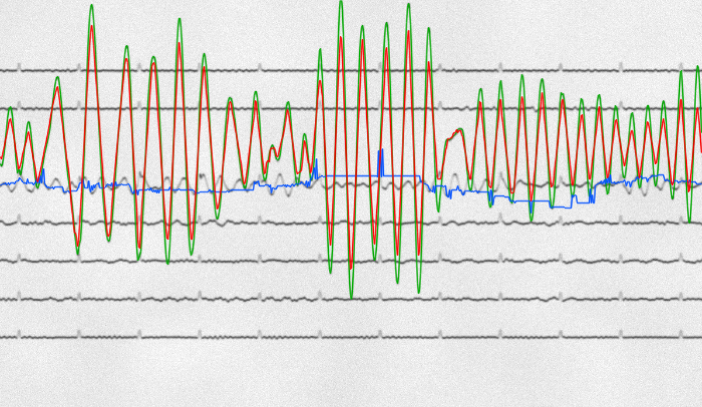
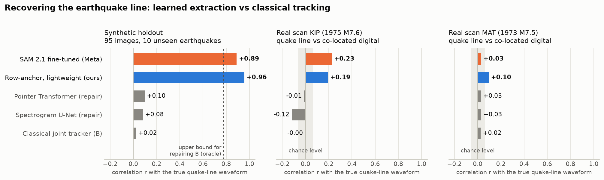
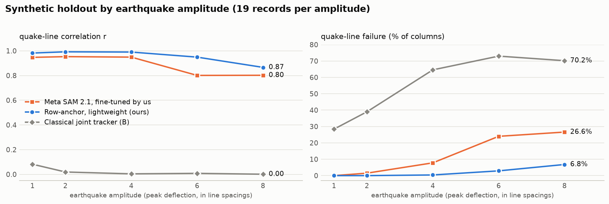
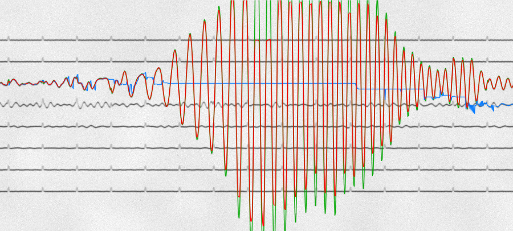
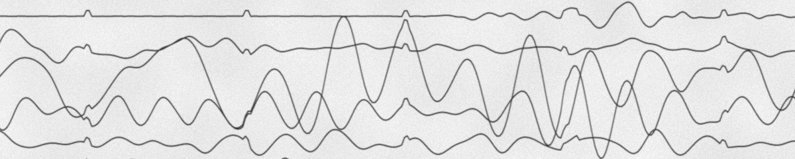
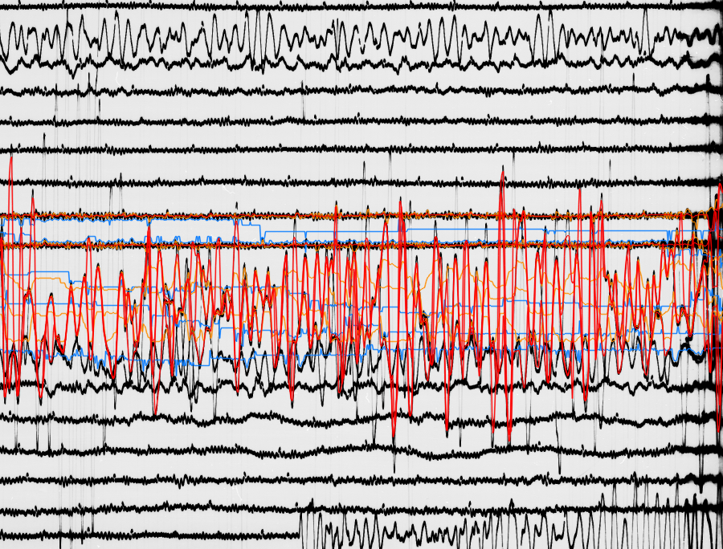
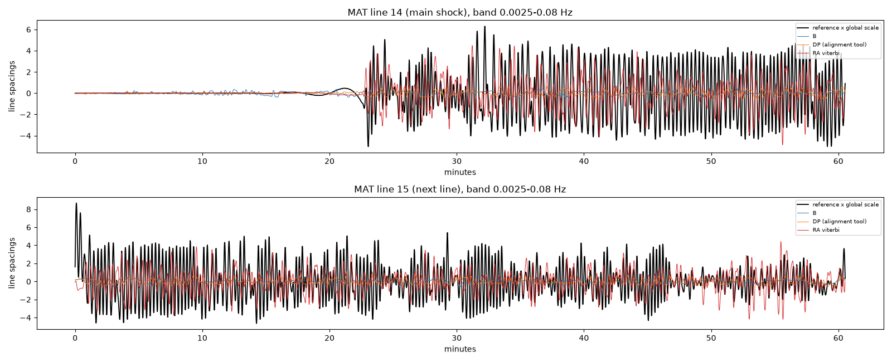
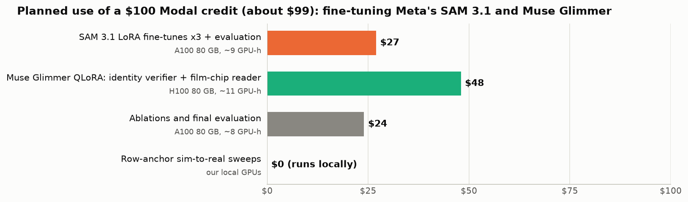
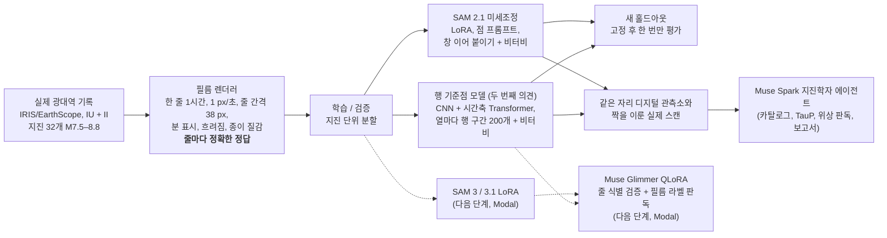

# SeismoRescue

<p align="center">
  <a href="README.md"></a>
  <a href="README.ko.md"></a>
</p>

**엉킨 아날로그 지진기록을 학습형 궤적 추출과 Meta SAM으로 다시 지진 파형으로 되살립니다.**

<p align="center">
  
</p>
<p align="center">🟩 <b>정답</b>&nbsp;&nbsp;&nbsp;🟥 <b>SAM 2.1 미세조정 (Meta)</b>&nbsp;&nbsp;&nbsp;🟦 <b>가장 좋은 고전 추적기</b></p>
<p align="center"><sub>새 홀드아웃: 모델이 본 적 없는 지진(IU.MAJO, 2009-10-07 M7.7), 흔들림은 줄 간격 4개.<br>SAM은 모든 교차점에서 지진 줄을 지키고, 고전 추적기는 교차가 시작되자마자 줄을 잃습니다.</sub></p>

> [!IMPORTANT]
> **Modal 크레딧으로 할 수 있게 되는 것: Meta 오픈 웨이트 모델 두 개가 파이프라인의 핵심 경로로 들어옵니다.**
> - **SAM 3 / 3.1을 LoRA로 미세조정**해 핵심 궤적 추출기로 씁니다. 미세조정한 SAM 2.1이 시뮬레이션에서 이미 지진 줄 실패율을 55%에서 12%로 줄였습니다.
> - **Muse Glimmer(30B)를 QLoRA로 미세조정**해 모든 교차점의 줄 식별 검증기이자 필름 라벨 판독기로 씁니다. 벤치마크에서 자동으로 만든 라벨 예제로 무제한 학습합니다.
> - 두 모델 모두 우리 로컬 GPU(M5 Pro 24 GB, RTX 5070 Ti 16 GB)에 들어가지 않습니다. 계획상 **$100 크레딧 중 약 $99**를 A100·H100 시간에 씁니다. **[전체 계획과 예산](#modal-크레딧으로-할-일)**을 참고하세요.

## 요약

- **문제.** 1962–1978년 WWSSN(세계 표준 지진 관측망)은 전 세계의 큰 지진을 사진 필름에 기록했습니다. USGS는 2025년에 필름칩 스캔을 CC0로 공개했습니다. 그런데 자동 디지털화는 신호가 가장 중요한 곳에서 무너집니다. 지진 줄이 이웃 줄 여러 개를 가로질러 수백 번 교차하고, 가파른 획은 필름에서 흐려지기 때문입니다.
- **벤치마크.** 큰 지진 32개(M7.5–8.8)의 실제 기록으로, 줄마다 정확한 정답이 있는 합성 WWSSN 장주기 필름을 만들었습니다. 기하는 실제 필름에 맞췄습니다. 1 px/초, 한 줄 1시간, 줄 간격당 38초입니다(실제 필름은 40–47초). 같은 자리에 디지털 관측소가 있던 실제 필름 스캔 2장도 찾아, 실제 정답으로 씁니다.
- **시뮬레이션 결과.** 새 홀드아웃(95장, 처음 보는 지진 10개, 방법마다 고정 후 한 번만 평가)에서 학습 모델이 지진 줄을 복원합니다. 지표는 지진 줄 상관계수 r과 실패율입니다.
  - **미세조정한 Meta SAM 2.1**: r **0.89**, 실패율 **12.0%** (고전 추적기 55%)
  - SAM의 독립적인 두 번째 의견인 가벼운 **행 기준점 모델**(매개변수 88만 개): r 0.96, 실패율 2.0%
  - 가장 좋은 고전 추적기: r 0.02, 실패율 55%
  - 고전 추적 결과를 사후에 고치는 방식은 스펙트로그램 U-Net을 포함해 모두 실패했습니다(r 약 0.1).
- **실제 필름의 솔직한 현황.** 실제 지진 줄은 **아직 풀지 못했습니다.** KIP r 0.19–0.23, MAT r 0.03–0.10이고, 우연 수준은 약 0.06입니다. 진폭이 중간인 줄에서는 MAT에서 이미 학습 모델이 고전 추적기를 앞섭니다(r 0.57–0.63 대 0.01). 남은 차이는 합성과 실제의 겉모습 차이로 보고 있고, 이를 줄이는 것이 다음 단계입니다([Modal 크레딧으로 할 일](#modal-크레딧으로-할-일) 참고).
- **Meta 모델.**
  - Muse Spark 1.3(Meta Model API)은 도구를 쓰는 지진학자 에이전트이자 교차 판정자로 실행했습니다. 단순 규칙을 이기지 못했다는 결과도 그대로 보고합니다.
  - SAM 3.1(Meta Model API)은 제로샷으로 시험했습니다. 선이 빽빽하게 닿는 구간에서는 인스턴스를 하나도 찾지 못해, 미세조정으로 방향을 잡았습니다.
  - SAM 2.1 오픈 웨이트를 미세조정한 모델이 위의 주 학습 추출기입니다.
  - **다음 단계, Modal 크레딧으로:**
    - **SAM 3 / 3.1**을 핵심 추출기로 미세조정합니다.
    - **Muse Glimmer**(30B, 오픈 웨이트)를 QLoRA로 미세조정해, 교차점의 줄 식별 검증기와 필름 라벨 판독기로 씁니다.
    - 두 역할 모두 파이프라인의 핵심입니다([Modal 크레딧으로 할 일](#modal-크레딧으로-할-일) 참고).

## 한눈에 보는 결과

<picture>
  <source media="(prefers-color-scheme: dark)" srcset="docs/img/chart_quake_r_dark.png">
  
</picture>

| 방법 (지진 줄) | 합성 홀드아웃 r | 합성 실패율 % | 실제 KIP r | 실제 MAT r |
|---|---|---|---|---|
| **SAM 2.1 hiera-tiny 미세조정** (Meta 오픈 웨이트) | 0.89 | 12.0 | **0.23** | 0.03 |
| **행 기준점 + 비터비** (가벼운 두 번째 의견 모델, 매개변수 88만 개) | **0.96** | **2.0** | 0.19 | **0.10** |
| B의 경로를 고치는 포인터 Transformer | 0.10 | 22.5 | −0.01 | 0.03 |
| B의 경로를 고치는 스펙트로그램 U-Net | 0.08 | 22.5 | −0.12 | 0.03 |
| 고전 다중 추적기 (B, 학습 없는 방법 중 최고) | 0.02 | 55.0 | −0.00 | 0.02 |
| *참고: 기준선에 그은 평평한 직선* | 0 | 22.5 | – | – |
| *상한: 매 열마다 맞는 B 선을 고르는 오라클* | 0.78 | 4.9 | – | – |

- **지표.**
  - **r**: 추출한 지진 줄 경로와 참 신호의 피어슨 상관계수입니다.
  - **실패율**: 경로가 없거나 줄 간격의 절반 넘게 벗어난 열의 비율입니다.
  - r을 주 지표로 쓰는 이유: 평평한 직선은 파형을 전혀 담지 않는데도 실패율로는 고전 추적기를 "이깁니다"(22.5% 대 55%).
- **합성 홀드아웃 film_holdout3.**
  - 학습에 쓰지 않은 지진 10개, 기록 19개 × 진폭 5종입니다.
  - 방법마다 검증 데이터로 설정을 고정한 뒤 한 번만 평가했습니다.
  - 행 기준점, SAM 2.1, B, 평평한 직선, 오라클의 합성 홀드아웃 숫자는 저장한 경로나 고정한 모델로 별도 스크립트를 써서 다시 계산했습니다([`results/ml/rescoring`](results/ml/rescoring)). 실패율은 각 실험의 이미지별 결과와 일치했고, 불일치는 0건이었습니다.
  - 수선 모델의 숫자와 실제 스캔 숫자는 각 실험이 낸 값입니다. 실제 스캔에서 B는 저장된 값을 그대로 재현합니다.
- **실제 스캔 채점.** 같은 자리 디지털 관측소 기록에 WWSSN 응답을 씌운 것을 정답으로 하고, 미리 저장한 시간 정렬 하나로 채점합니다. 자세한 내용은 [docs/RESULTS.md](docs/RESULTS.md)(영문)에 있습니다.

<picture>
  <source media="(prefers-color-scheme: dark)" srcset="docs/img/chart_amplitude_dark.png">
  
</picture>

두 학습 모델은 진폭이 줄 간격 8개까지 커져도 r 0.80 이상을 유지합니다. 고전 추적기는 어떤 진폭에서도 파형을 복원하지 못합니다(r 0.08 이하).

<p align="center">
  
</p>
<p align="center">🟩 <b>정답</b>&nbsp;&nbsp;&nbsp;🟥 <b>행 기준점 (가벼운 두 번째 의견)</b>&nbsp;&nbsp;&nbsp;🟦 <b>고전 추적기</b></p>
<p align="center"><sub>흔들림 줄 간격 8개(II.RAYN, 2010-04-06 M7.8).<br>SAM과 행 기준점 모델이 엇갈리는 곳을 Glimmer 검증기가 판정합니다.</sub></p>

## 왜 어려운가: 그림 한 장

<p align="center">
  
</p>
<p align="center"><sub>진폭 2배, 선 접촉 56회인 합성 구간입니다. Meta Model API의 SAM 3.1은 제로샷으로 여기서 <b>인스턴스 0개</b>를 돌려줍니다. 고전 추적기는 열의 58%에서 실패합니다. 모든 선이 똑같이 생겼으므로, 교차점마다 어느 줄인지는 앞뒤 맥락으로 판단해야 합니다.</sub></p>

## 실제 필름: 지금 어디까지 왔나

<p align="center">
  
  
</p>
<p align="center">🟥 <b>행 기준점</b>&nbsp;&nbsp;&nbsp;🟦 <b>고전 B</b>&nbsp;&nbsp;&nbsp;🟧 <b>DP 정렬 도구</b>&nbsp;&nbsp;&nbsp;⬛ <b>디지털 정답</b> (아래 그래프)</p>
<p align="center"><sub>마쓰시로(MAT)의 실제 필름, 1973-12-28 M7.5 바누아투 지진. 위: 추출 경로를 겹친 스캔. 아래: 같은 자리 HGLP 디지털 관측소의 정답.<br>참 흔들림은 줄 간격 4–6개이고, 모델은 그 일부만 따라갑니다.<br>스캔: USGS WWSSN 시범 스캔 사업의 EarthScope 필름칩 제품(USGS CC0 공개본의 일부로 문서화, 파일 단위 대조는 안 함). 정답: EarthScope FDSN의 HG.MAT.</sub></p>

| 실제 스캔, 줄 종류별 r | SAM 2.1 미세조정 | 행 기준점 | 고전 B | DP 정렬 도구 |
|---|---|---|---|---|
| MAT 지진 줄 (14) | 0.03 | **0.10** | 0.02 | −0.04 |
| MAT 이웃 줄 (13, 15) | −0.04 | 0.04 | 0.02 | **0.08** |
| MAT 다른 활성 줄 (7줄) | 0.57 | **0.63** | 0.01 | 0.49 |
| KIP 지진 줄 (16) | **0.23** | 0.19 | −0.00 | 0.09 |
| KIP 이웃 줄 (15, 17) | 0.12 | **0.17** | 0.02 | 0.14 |
| KIP 다른 활성 줄 (5줄) | 0.15 | 0.18 | 0.10 | **0.32** |

실제 필름 성능을 막는다고 보는 요인입니다. 아직 가설이며, 지금 시험하고 있습니다.
1. 실제 필름에서는 가파른 획이 거의 보이지 않습니다. 우리 렌더러가 그리는 것보다 흐립니다.
2. MAT에서는 이웃 줄 여러 개가 동시에 크게 흔들립니다. 학습 데이터에는 드문 경우입니다.
3. 합성 필름에는 없는 스캔 잡음이 있습니다.

## Modal 크레딧으로 할 일

<picture>
  <source media="(prefers-color-scheme: dark)" srcset="docs/img/chart_modal_budget_dark.png">
  
</picture>

| | **SAM 3 / 3.1 미세조정** | **Muse Glimmer 미세조정** |
|---|---|---|
| **파이프라인에서의 역할** | 모든 줄의 핵심 궤적 추출기. 가벼운 행 기준점 모델은 독립적인 두 번째 의견으로 남습니다. | (1) **줄 식별 검증기**: 추출기들이 엇갈리는 교차점마다 진짜 경로를 고르거나, 사람 검토가 필요하다고 표시합니다. (2) **필름 라벨 판독기**: 관측소, 날짜, 시작 시각, 시계 보정을 읽어 시간 정렬의 출발점으로 씁니다. |
| **방법** | SAM 3의 정지 영상 점 프롬프트 경로를 전체 해상도 LoRA로 학습합니다(코드 준비 완료, 무작위 가중치로 시험). SAM 3.1의 변경점은 영상 다중 객체 추적이라, 공식 학습 경로가 갖춰지면 비교합니다. SAM 2.1 때와 같은 고정-홀드아웃 절차입니다. | 벤치마크에서 렌더링하고 정확한 정답으로 라벨을 붙인 교차 구간 예제로 무제한 QLoRA 학습합니다. |
| **Modal이 필요한 이유** | 전체 해상도 LoRA에는 A100/H100급 메모리가 필요합니다. | 4-bit 가중치가 약 18 GB로, 우리 16 GB GPU보다 큽니다. QLoRA는 H100 1장에서 되는 것으로 문서화되어 있습니다. |
| **성공 기준** | 처음 보는 지진으로 된 새 홀드아웃에서 미세조정 SAM 2.1(r 0.89)을 넘을 것. 실제 스캔 r도 보고합니다. | 검증기: 처음 보는 지진에서 학습한 로지스틱 판정자보다 기록 단위 정확도가 높을 것. 판독기: 사람이 확인한 라벨 대비 항목 정확도. |
| **예산 (추정)** | 약 $27: A100 80 GB, 약 9 GPU 시간, 3회 학습 + 평가 | 약 $48: H100 80 GB, 약 11 GPU 시간, 2–3회 학습 + 평가 |

목표 파이프라인은 Meta 모델을 핵심 경로에 둡니다.
- **SAM 3 / 3.1**이 모든 줄을 추출하고, 가벼운 행 기준점 모델이 독립적인 두 번째 의견을 냅니다.
- 둘이 엇갈리는 곳에서는 **Glimmer**가 줄 식별을 검증하고, 필름 라벨도 읽습니다.
- **Muse Spark**가 전체를 지휘하고 지진학 보고서를 씁니다.

미세조정이 필요한 이유는 다음과 같습니다. 제로샷 Spark는 교차 판정에 도움이 되지 않았고(34건 고침, 60건 망침), 제로샷 SAM 3.1은 선이 닿는 곳에서 아무것도 찾지 못했습니다. 두 모델 모두에 필요한 것은 정확한 라벨이고, 우리 벤치마크는 이를 무제한으로 만들 수 있습니다.

Modal 작업과 함께 진행하는 일:
- **합성-실제 차이 줄이기 (진행 중, 우리 GPU에서 실행).**
  - 시험에 쓰지 않는 CC0 필름 스캔에서 획이 보이는 정도, 굵기, 번짐, 여러 줄의 동시 흔들림을 잽니다.
  - 잰 범위 안에서 렌더러를 무작위화하고, 작은 행 기준점 모델을 로컬에서 다시 학습합니다.
  - 새 홀드아웃으로 시험한 뒤, 실제 짝 기록으로 한 번 평가합니다.
- **실제 정답 늘리기.** WWSSN ↔ HGLP/SRO 짝(ALQ, CTA, CHG 등)을 더 모읍니다.
- **공개.** 디지털화 CLI, 벤치마크 생성기, 미세조정한 SAM 3 / 3.1·Glimmer 어댑터를 공개합니다. Glimmer는 직접 호스팅하므로, USGS 아카이브 18.9만 장을 호출당 API 비용 없이 처리할 수 있습니다.

**예산 계산 방법.**
- Modal 정가(2026-10-27 확인): A100 80 GB 시간당 $2.50, H100 $3.95. CPU 4코어와 메모리 32 GB에 시간당 약 $0.44가 더 듭니다.
- 남는 약 $24는 A100에서 제거 실험(ablation)과 최종 평가에 씁니다.
- 작은 모델은 로컬 GPU에서 돌리므로 비용이 들지 않습니다.

## 작동 방식



- **SAM 2.1 미세조정** ([`scripts/ml_sam.py`](scripts/ml_sam.py))
  - SAM 2.1 hiera-tiny의 단일 이미지 경로를 순수 PyTorch로 다시 구현했습니다. 공식 가중치가 키와 모양 검사를 엄격하게 통과해 그대로 로드됩니다.
  - 트렁크에 LoRA를 적용하고, 마스크 디코더를 학습합니다.
  - 창 하나는 전체 높이 × 256열이고 1024²로 늘립니다. 첫 창은 시작점으로, 이후 창은 지금까지 디코딩한 경로 위의 점 4개로 프롬프트합니다. 창들은 비터비로 이어 붙입니다.
  - MPS에서 45분 학습했습니다.
- **행 기준점 모델** (우리 방법, 가벼운 두 번째 의견 모델, [`scripts/ml_rowanchor.py`](scripts/ml_rowanchor.py))
  - 입력: 표적 줄의 기준선을 가운데 둔 ±10.5 줄 간격 범위를 절반 해상도로 잘라 씁니다. 여기에 시작 힌트 채널을 더합니다. 첫 열에서 그 줄의 위치로, 고전 추적기가 받는 시작 정보와 같습니다.
  - 작은 CNN이 행 방향을 압축하고, 4층 Transformer가 시간축을 따라 앞뒤 맥락을 봅니다.
  - 열마다 4 px 크기의 행 구간 200개 중 하나로 분류합니다. 비터비 디코딩에는 학습 데이터에서 배운 이동 확률을 씁니다.
  - 학습 때는 다른 기록을 표적 위아래에 이어 붙여, 잘라낸 이미지가 실제 24줄 필름처럼 보이게 합니다.
  - 매개변수는 88만 개이고, Apple M5 Pro(MPS)에서 52분 학습했습니다.
- **고전 기준 방법** ([`scripts/track_joint.py`](scripts/track_joint.py), [`scripts/arbiter.py`](scripts/arbiter.py))
  - A는 탐욕 추적기이고, B는 물리 기반 관성 추적을 하는 다중 줄 동시 추적기입니다.
  - A와 B가 엇갈리는 곳에서는 학습한 판정자가 둘 중 하나를 고릅니다.
  - 처음 쓰던 4 px/초 기하의 사전 등록 홀드아웃에서, 이 판정자는 이미지 전체 실패율을 탐욕 추적기보다 11.5%p 낮췄습니다. 기록마다 두 추적기 중 나은 쪽과 비교하면 2.5%p 낮습니다. 하지만 실제 필름 기하에서는 통하지 않습니다.
- **수선 모델** ([`scripts/ml_repair.py`](scripts/ml_repair.py))
  - 이미지가 아니라 B의 줄별 경로를 참 파형으로 바꾸는 모델입니다.
  - 실패했습니다. B의 줄별 경로만으로는 줄이 뒤바뀐 구간을 되돌리지 못했고, 이미지를 직접 읽는 모델은 되돌렸습니다.

## 이 프로젝트의 Meta 모델

| 모델 | 역할 | 측정 결과 |
|---|---|---|
| **Muse Spark 1.3** (Meta Model API, `muse-spark-1.3-contributor`) | 디지털화된 파형 위에서 도구를 쓰는 지진학자 에이전트입니다. 도구는 지진 카탈로그 + TauP 도달 시간, STA/LTA, AIC 위상 판독기, 그림입니다. 교차점의 A/B 판정자로도 시험했습니다. | 독립된 두 번의 실행이 기록의 93–94%에서 같은 결론을 냈고, 96회 실행에 약 $1.7가 들었습니다. **단순 규칙을 이기지 못했습니다.** P파를 10초 안에 맞힌 비율은 0.67로, 이론 도달 시간의 0.71보다 낮습니다. 교차 판정자로는 가장 강한 판정자 대비 34건을 고치고 60건을 망쳤습니다(기록 단위로는 유의하지 않고, 해로운 쪽 경향). 그래서 Spark는 지휘와 보고를 맡고, 측정은 도구가 합니다. |
| **SAM 3.1** (Meta Model API) | 제로샷 궤적 분할 | 떨어져 있는 단일 선은 잘 찾습니다. 선이 56–212번 닿는 구간에서는 **인스턴스 0개**입니다. 한 줄만 흔들리고 접촉이 28–40번이면 그 줄은 따라가지만(실패 0.2% 이하), 조용한 줄을 빠뜨려 전체 줄 기준 실패율은 40–69%입니다. |
| **SAM 2.1 hiera-tiny** (오픈 웨이트, Apache-2.0) | 미세조정한 프롬프트형 궤적 분할기 | 합성 홀드아웃 r 0.89. 지진 줄 실패율 55% → 12%. 실제 KIP r 0.23. |
| **SAM 3 / 3.1** (오픈 웨이트, 승인제) | **다음 단계(Modal): 핵심 궤적 추출기.** SAM 3의 정지 영상 점 프롬프트 경로를 LoRA로 미세조정합니다(코드 준비 완료, 무작위 가중치로 시험). SAM 3.1은 공식 학습 경로가 갖춰지면 비교합니다. SAM 2.1과 같은 고정-홀드아웃 절차입니다. | 계획 |
| **Muse Glimmer** (오픈 웨이트, 30B, 이미지+텍스트 입력, Apache-2.0) | **다음 단계(Modal), 두 가지 핵심 역할.** (1) **줄 식별 검증기**: 추출기들이 엇갈리는 모든 교차점에서, 후보 경로를 그린 이미지를 보고 진짜를 고르거나 사람 검토가 필요하다고 표시합니다. 정답이 정확한 우리 벤치마크에서 교차 구간 예제를 자동으로 무제한 만들어 QLoRA로 학습합니다. (2) **필름 라벨 판독기**: 관측소, 날짜, 시작 시각, 시계 보정 라벨을 읽어 스캔마다 시간 정렬의 출발점을 줍니다. 실제 스캔 평가에서 라벨 시각만으로는 부족했으므로, 이 값으로 맞춤 정렬을 시작합니다. 대량 디지털화를 위해 직접 호스팅합니다. | 계획 단계이며 아직 시험하지 않았습니다. 제로샷 Spark는 판정자로 도움이 되지 않았으므로(34건 고침, 60건 망침), 정확한 라벨로 학습할 계획입니다. Glimmer는 4-bit로도 18 GB라 H100이 필요합니다. |

## 평가 방식

- **정확한 정답.** 렌더러가 모든 줄의 펜 중심선을 저장합니다. 검토 중 반 픽셀 어긋남 버그를 찾아 고쳤고, 다시 잰 잔차는 0.003 px입니다.
- **지진 단위 분할.** 개발에는 사건 날짜 기준 GroupKFold(4겹 × 3회 섞기)를 씁니다. 같은 지진이 학습과 시험에 동시에 들어가지 않습니다.
- **새 홀드아웃, 방법마다 한 번만 평가.** 새 지진 10개로 된 홀드아웃이 3개입니다. 2개는 고전 시스템용으로 가설을 사전 등록했고, film_holdout3은 학습 모델용입니다(세 실험이 각자 고정한 방법을 한 번씩 평가). 신뢰구간은 기록 단위 클러스터 부트스트랩으로 구합니다.
- **독립 확인.**
  - 홀드아웃 숫자는 별도 스크립트로 다시 계산했습니다([`results/ml/rescoring`](results/ml/rescoring)).
  - 독립 검토자가 문서를 결과 파일과 대조해, 우리 초안의 과장을 잡아냈고 모두 고쳤습니다.
  - 부정적인 결과도 보고합니다. Spark 판정자, Spark 에이전트 대 단순 규칙, 수선 모델, 실제 필름으로의 전이가 그렇습니다.
- **실제 정답.** 같은 자리에 HGLP 디지털 관측소가 있고, 디지털 기록이 포화되지 않은 WWSSN 장주기 필름 2장을 씁니다.
  - MAT: 1973-12-28 M7.5
  - KIP: 1975-02-02 M7.6
  - 디지털 기록은 WWSSN 장주기 응답으로 바꿉니다. 스캔과 시간의 정렬은 어떤 방법도 채점하기 전에 한 번 맞춰 저장했습니다. 실제 한 줄의 길이는 3600초가 아니라 3588–3589초입니다.

## 저장소 구성

| 경로 | 내용 |
|---|---|
| [`scripts/`](scripts) | 모든 코드: 렌더러, 고전 추적기와 판정자, 학습 모델, 실제 짝 평가, Spark 에이전트 도구 |
| [`data/`](data) | 벤치마크 파형(miniSEED, IU/II)과 지진 카탈로그. 출처, 라이선스, 실제 스캔 받는 법은 [data/README.md](data/README.md)(영문) |
| [`results/`](results) | 결과 파일: `early/`(초기 실험), `early/multiagent/`(교차검증, 홀드아웃, Spark 실행), `ml/`(학습 모델, 실제 짝 평가, 재계산) |
| [`checkpoints/`](checkpoints) | 고정된 행 기준점 모델(3.5 MB)과 미세조정한 SAM 2.1 tiny(19 MB), 각각의 고정 디코딩 설정 |
| [`docs/`](docs) | [RESULTS.md](docs/RESULTS.md)(모든 실험의 조건과 숫자, 영문), [METHODS.md](docs/METHODS.md)(영문), 그림 |
| [`tools/`](tools) | 결과 파일로 README 요약과 그래프를 다시 만드는 도구 |

## 재현

```bash
./setup_env.sh                                   # 고정 버전 패키지로 Python 3.12 가상환경 생성 (uv 필요)
SKIP_API=1 ./run_all.sh                          # 초기 실험 중 오프라인 부분 (API 키 불필요)

# 필름 기하 벤치마크: 포함된 파형으로 학습·홀드아웃 필름 렌더링
for f in data/film_dev/*.mseed; do t=$(basename "$f" .mseed); .venv/bin/python -I scripts/render_helicorder.py "$f" out/film_train/$t film 1,2,3,4,6,8; done
for f in data/film_holdout3/*.mseed; do t=$(basename "$f" .mseed); .venv/bin/python -I scripts/render_helicorder.py "$f" out/film_holdout3/$t film 1,2,4,6,8; done

# 행 기준점 모델: 학습 → 검증으로 디코딩 선택 → 고정 → 한 번만 시험
.venv/bin/python -I scripts/ml_rowanchor.py split
.venv/bin/python -I scripts/ml_rowanchor.py train 50
.venv/bin/python -I scripts/ml_rowanchor.py cacheB val && .venv/bin/python -I scripts/ml_rowanchor.py cacheB holdout   # 비교용 고전 B
.venv/bin/python -I scripts/ml_rowanchor.py val && .venv/bin/python -I scripts/ml_rowanchor.py freeze
.venv/bin/python -I scripts/ml_rowanchor.py holdout

# 또는 포함된 체크포인트로 평가
mkdir -p out/ml/rowanchor && cp checkpoints/rowanchor/* out/ml/rowanchor/
python tools/collect_summary.py && python tools/make_figures.py   # README 숫자와 그래프 다시 만들기
```

- Spark와 SAM 3.1 단계에는 `MODEL_API_KEY`에 Meta Model API 키가 필요합니다.
- 실제 짝 평가에는 필름 스캔 2장과 HGLP 기록이 필요합니다. 받는 곳은 [data/README.md](data/README.md)에 있습니다.
- 전체 명령 목록은 각 스크립트 맨 위 설명에 있습니다.

## 데이터와 라이선스

- 코드: MIT ([LICENSE](LICENSE)).
- 미세조정한 SAM 2.1 체크포인트는 Meta SAM 2.1(Apache-2.0)의 파생물입니다.
- 파형: IRIS/EarthScope FDSN, IU 관측망([doi:10.7914/SN/IU](https://doi.org/10.7914/SN/IU))과 II 관측망([doi:10.7914/SN/II](https://doi.org/10.7914/SN/II)).
- WWSSN 필름칩 스캔: USGS([doi:10.5066/P13PHZMA](https://doi.org/10.5066/P13PHZMA), CC0 1.0)와 EarthScope 필름칩 제품([doi:10.17611/DP/FC.1](https://doi.org/10.17611/DP/FC.1)). MAT 스캔은 뒤의 제품에서 받았고, 이 제품은 CC0 공개본의 일부로 문서화되어 있습니다(파일 단위 대조는 안 함).
- KIP 스캔은 미러에서 받은 로컬 사본입니다. USGS CC0 공개본에서 직접 받기 전까지, 이 저장소에는 **KIP 이미지가 없고** 숫자만 있습니다.
- 자세한 내용은 [THIRD_PARTY_NOTICES.md](THIRD_PARTY_NOTICES.md)에 있습니다.

Meta Global AI Developer Hackathon(2026년 10월 26일 – 11월 4일, Indie 트랙)에 혼자 참가해 만들었습니다. 규칙이 허용하는 대로 AI 코딩 도구의 도움을 받아 개발했습니다.
