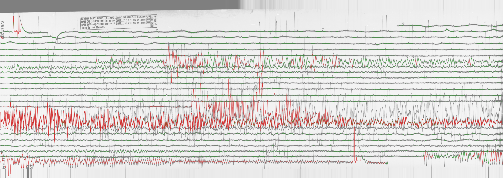
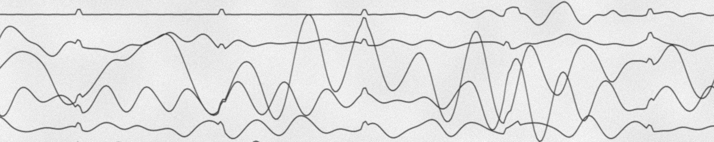
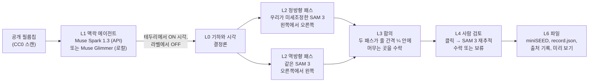
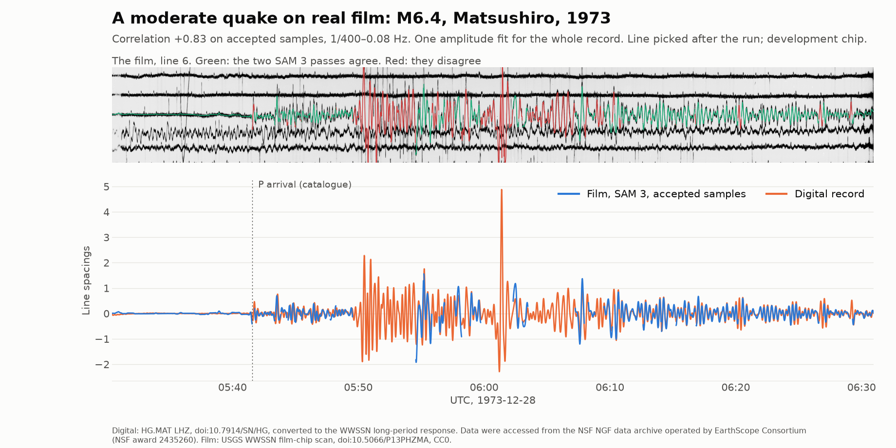
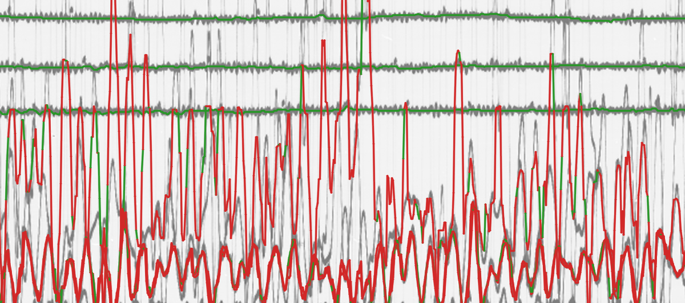
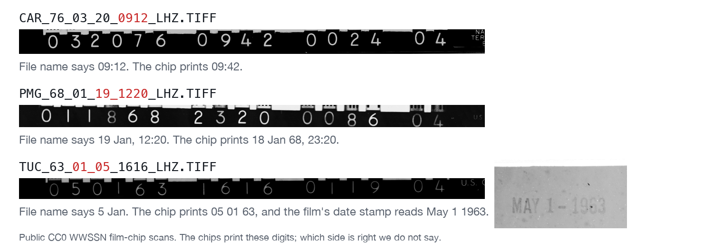
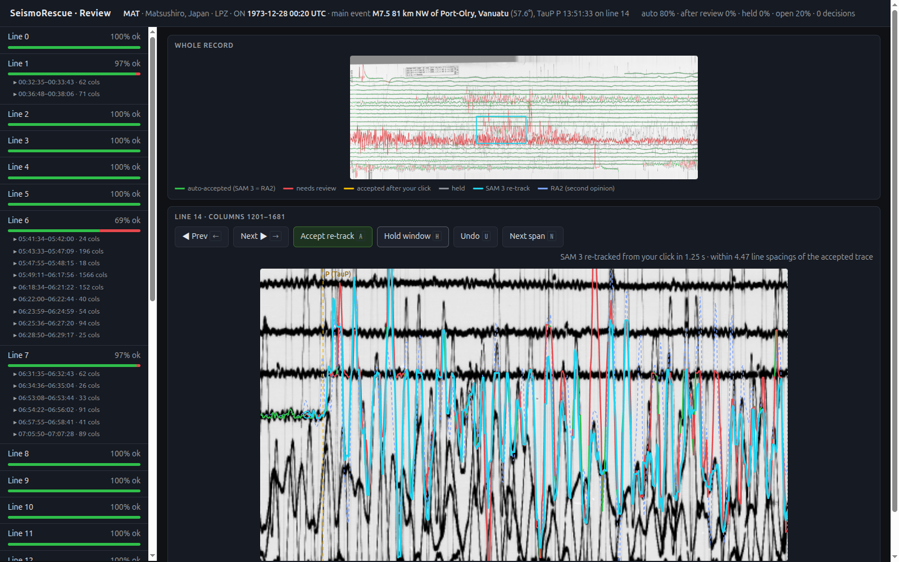
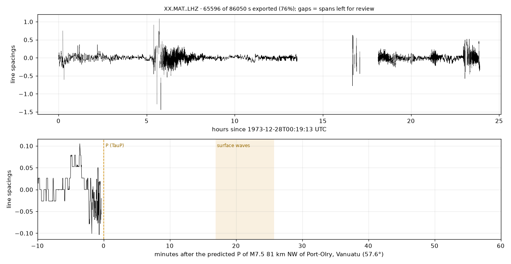

# SeismoRescue

<p align="center">
  <a href="README.md"></a>
  <a href="README.ko.md"></a>
</p>

**1970년대 지진 필름을 Meta SAM 3와 Muse 모델로 읽는다. 추적기의 두 패스가 어긋나는 곳은 사람이 결정한다.**

<p align="center">
  
</p>
<p align="center"><sub>실제 필름칩, 마쓰시로(MAT), 1973-12-28, 공개 CC0 스캔. 우리가 미세조정한 SAM 3가 모든 줄을 두 번 추적한다. 왼쪽에서 오른쪽으로, 이어서 오른쪽에서 왼쪽으로.<br>
🟩 자동 수락: 두 패스가 줄 간격 ¼ 안에 20열 이상 머문다. 🟥 분쟁: 사람 검토로 보낸다.<br>
빨강은 엉킨 지진 줄(14–18번), 6번 줄의 작은 지진, 한 패스가 줄을 놓친 마지막 줄에 있다. Spark 호출을 포함해 RTX 5070 Ti 한 장에서 8.5분이 걸렸고, 기록 열의 76.1%를 수락했다.</sub></p>

## 바로 해 보기: 키, GPU, 계정 없이

[uv](https://docs.astral.sh/uv/)와 디스크가 필요하다. 맥은 약 1.5 GB, 리눅스는 약 6 GB다(PyTorch가 CUDA 라이브러리를 가져온다). 위의 1973년 실제 칩을 노트북에서 돌린다.

```bash
git clone https://github.com/smpark00/seismorescue && cd seismorescue
./setup_env.sh      # 고정 버전 패키지로 Python 3.12 가상환경
./bootstrap.sh      # 함께 받은 체크포인트, 결과, MAT 예시를 out/ 아래에 둔다

# 1. 저장된 SAM 3 경로에 L0와 합의 규칙을 실제로 돌린다. overlay.png, quake.png, provenance.json을 쓴다
.venv/bin/python -I scripts/rescue.py data/real_scans/MAT_73_12_28_0020_LHZ.TIFF --reuse --on 1973-12-28T00:20:00 --off 1973-12-29T00:13:00

# 2. 파일: miniSEED를 쓰고 ObsPy로 다시 읽는다. export.json, quicklook.png
.venv/bin/python -I scripts/export_mseed.py export out/rescue/MAT_73_12_28_0020_LHZ

# 3. 테두리 판독 점수. Spark의 저장된 응답과 관측소 번호표로 낸다
.venv/bin/python -I scripts/l1_context.py replay
.venv/bin/python -I scripts/show_l1.py out/rescue/MAT_73_12_28_0020_LHZ      # 이 칩에서 Spark가 한 일: 요청, 도구 호출, 응답

# 4. 저장된 재추적으로 여는 검토 화면: http://127.0.0.1:8791/ (선을 클릭, A 수락, H 보류, N 다음 구간, Ctrl-C로 끝)
.venv/bin/python -I scripts/review_server.py out/rescue/MAT_73_12_28_0020_LHZ --replay
```

차례로 `accepted 76.1% of trace columns`, `65401 of 86050 s exported`, `'all4': '25/30'`이 나오고, 빨간 **RECORDED RUN** 띠가 있는 화면이 열린다. 결과는 `out/rescue/MAT_73_12_28_0020_LHZ/`에 있다. 화면에서는 18번 줄의 첫 구간을 눌러 보자. 왼쪽에서 오른쪽으로 가는 패스는 위쪽의 큰 진동으로 넘어갔고, 오른쪽에서 왼쪽으로 가는 패스는 줄 위에 남아서 둘이 어긋난다. 저장된 재추적은 잉크 위에 머문다. 24번 줄에서는 저장된 클릭이 줄을 벗어난 역방향 패스 위에 있어서 재추적이 화면 밖으로 나간다. 재추적은 클릭만큼만 좋다. 그래서 사람이 결정한다.

| 단계 | 위 경로에서 | 실제로 돌리려면 ([재현](#재현)) |
|---|---|---|
| L0 기하와 시각, 합의 규칙, miniSEED, 관측소 번호표 | **실제 실행** | 더 필요 없음 |
| Muse Spark 테두리 판독 | 저장본: `results/e4/responses/`, 요청·도구 호출·응답 전부는 `examples/MAT_73_12_28_0020_LHZ/l1/l1_transcript.json` | Meta Model API 키 ([.env.example](.env.example)) |
| Muse Glimmer 테두리 판독 | 저장본: `results/e9/responses/` | llama.cpp, 오픈 웨이트 18 GB, 16 GB GPU |
| SAM 3가 모든 줄을 양방향으로 추적 | 저장본: `paths.npz` | **게이트 접근과 GPU:** `facebook/sam3` 접근 승인을 직접 받아야 한다(기본 가중치를 재배포하지 않는다) |
| 클릭 뒤 SAM 3 재추적 | 저장된 재추적 66개, 녹화라고 표시한다. 스크립트가 검토 창마다 역방향 패스의 경로 위를 한 번씩 클릭했고(73개 중 66개. 나머지 7개는 클릭할 경로가 없거나 줄 끝에 너무 가깝다), 우리는 그중 몇 개만 봤다. 화면은 그 창의 저장된 재추적을 보여 줄 뿐, 내 클릭에 반응하는 것이 아니다 | **게이트 접근과 GPU** 뒤 `--replay`를 뺀다 |

**게이트 접근과 GPU가 필요한 것:** SAM 3 두 행뿐이다. 그 접근이 있으면 [재현](#재현)으로 영상의 전체 데모를 이 저장소에서 돌릴 수 있다. 없으면 위의 녹화 실행을 보게 되고, 그 근거인 로그, 추적, 출력이 [`results/logs/`](results/logs)와 [`examples/`](examples)에 있다.

## 한 문단 요약

1962–1978년 WWSSN(세계 표준 지진 관측망)은 전 세계의 지진을 사진 필름에 기록했다. USGS는 2025년에 이 필름칩 스캔을 CC0로 공개했다. 칩을 다시 데이터로 바꾸는 일은 가장 중요한 곳에서 무너진다. 지진 줄이 이웃 줄을 가로지르며 수백 번 교차하기 때문이다. SeismoRescue는 공개 칩 한 장을 받아 파일을 낸다. 기록 정보(관측소, 시작 시각, 지진과 그 지진이 놓일 줄), 추적기의 두 패스가 맞는 구간만 담은 miniSEED 파형, 나머지를 위한 검토 목록이다. **우리가 미세조정한 Meta SAM 3**가 모든 줄을 양쪽 끝에서 추적하고, 사람이 맞는 획을 클릭하면 그 구간을 다시 추적한다. **Muse Spark**는 필름 테두리에 인쇄된 숫자를 읽고 결정론 도구를 부른다. Meta의 오픈 웨이트 모델 **Muse Glimmer**는 같은 판독을 우리 GPU에서 한다. 그래서 밖으로 보낼 수 없는 스캔도 이 컴퓨터를 떠나지 않는다. 런타임에 호출하는 모델은 모두 Meta 모델이다. 엉킨 지진 줄은 여전히 대부분 사람 일이다. 처음 보는 지진 10개(합성 필름)에서 수락한 지진 줄 열의 94.2%가 줄 간격 ¼ 안이었다. 같은 열에서 평평한 직선은 72.5%다. 실제 필름에서는 중간 규모 지진 두 건에서 수락한 경로가 디지털 기록의 모양을 따라갔다(r +0.91, +0.83). 큰 지진 두 건에서는 그렇지 않았다. 한 건은 거의 수락되지 않았고, 다른 한 건은 수락한 절반이 평평한 직선보다 낫지 않았다. 그 부분은 사람에게 간다.

## 한눈에 보기

| 항목 | 결과 | 데이터 | 종류 |
|---|---|---|---|
| 지진 줄, 자동 수락한 열 | **94.2%**가 줄 간격 ¼ 안 (같은 열의 평평한 직선 72.5%), 열의 87.9%를 남김 | 처음 보는 지진 10개, 합성 필름 95장 | 시험 |
| 지진 줄, 펜이 실제로 움직인 열 | ¼ 안 비율: SAM 3 정방향 단독 67.2%, 규칙이 수락한 열 **80.6%**, 그 열의 70.8%를 수락 (평평한 직선은 정의상 0%) | 같음 | 시험 |
| 전체 줄, 자동 수락한 열 | **97.9%**가 ¼ 안 (평평한 직선 93.6%), 내보내기가 어차피 잇는 분 표시를 빼면 **99.2%** (평평한 직선 95.3%), 93.9%를 남김 | 같음 | 시험 |
| 실제 필름, 중간 규모 지진 2건 | 수락 구간 r **+0.91**(ALQ 1975, Ms 6.3), **+0.83**(MAT 1973, M6.4, 사후에 고른 줄), 디지털 기록 대비 | 칩 2장 | 기술용 |
| 실제 필름, 큰 지진 2건 | MAT, M7.5: 지진 줄을 거의 수락하지 못했다. KIP, M7.6: 50% 수락, r −0.22, 거기서는 평평한 직선 점수가 더 높다. 사람 몫이다 | 칩 2장 | 기술용 |
| 테두리 판독, Spark + 번호표 | 아카이브 파일 이름 기준 칩 **16/20** 정답. 나머지 4장은 에이전트가 칩 자체와 맞다(시험 뒤 눈으로 확인) | 새 공개 칩 20장 | 시험 |
| 새 공개 칩 300장, 무인 | 에이전트가 **297/300** 완주했다. 적어도 **32장**에서 파일 이름이 칩의 인쇄 내용과 다르다. L0는 164/297에서 시간 모델을 냈고, 그 정확도는 여기서 재지 않았다 | 새 공개 칩 300장 | 사전 등록한 한 번 실행, 시각 정답 없음 |
| 우리 GPU의 Glimmer 대 Spark | 칩 정답 24/30 대 25/30 | 공개 칩 30장 | 기술용 |
| 클릭 한 번 뒤 SAM 3 재추적 | ¼ 안 비율, 전체 줄: 42.8% → 55.8% (평평한 직선 35.7%, 역방향 패스 47.7%). 지진 줄: 38.3% → 48.0%, 이득이 드러나지 않음 | 합성 개발 세트 | 개발 |
| miniSEED 시각 | 같은 자리 1973년 디지털 기록과 약 2초 안 | MAT 칩 | 개발 점검 |

"시험"은 방법을 고정한 뒤, 본 적 없는 데이터에서 한 번만 돌린 결과다. 기준선에 놓인 평평한 직선은 실력이 없으니, 점수 가운데 땅이 움직이지 않아서 얻은 몫을 보여 준다. 위치 점수와 함께 적고, 없는 하나는 없다고 적는다. 자세한 수치와 구간은 [결과](#결과)에, 아직 안 되는 것은 [한계](#한계)에 있다.

## 문제

- WWSSN 장주기 칩 한 장에는 약 하루치 지반 운동이 담긴다. 한 줄이 한 시간이고(실제 필름은 3588–3589초), 줄은 약 24개이며, 1분마다 눈금이 찍힌다.
- 조용한 줄은 쉽다. 지진 줄은 어렵다. 큰 지진 두 건(MAT, KIP)에서 흔들림은 줄 간격의 4.8–8.7배라서, 이웃 줄을 거듭 가로지르고 가파른 획은 흐려진다.
- 모든 줄이 똑같이 생겼다. 교차점에서 어느 획이 어느 줄인지는 앞뒤 맥락으로 정해야 한다.

<p align="center">
  
</p>
<p align="center"><sub>진폭 2배 합성 크롭, 선 접촉 56곳. Meta Model API의 SAM 3.1을 제로샷으로 돌리면 여기서 <b>인스턴스 0개</b>를 낸다.<br>고전 추적기는 열의 58%에서 실패한다(첫 필름 기하, 평평한 직선은 계산하지 않음). 그래서 SAM 3를 미세조정하고 줄마다 양쪽 끝에서 추적한다.</sub></p>

## 하는 일



| 층 | 하는 일 | 모델 |
|---|---|---|
| **L0** 기하와 시각 | 기록 영역과 극성을 찾고, 줄을 수평으로 맞추고 기준선을 찾는다. 분 눈금으로 초당 픽셀과 줄 주기를 잰다. 선이 시작한 뒤 첫 분 눈금을 ON 시각으로 둔다. 결과: 픽셀마다 UTC 시각. | 없음 (결정론) |
| **L1** 맥락 에이전트 | 인쇄된 테두리 숫자 16개(ON 날짜, ON 시각, 관측소 번호, 성분 코드)와 라벨을 읽는다. 도구 네 개를 부른다. `decode_border`(관측소 번호표), `station_by_code`, `measure_record`(읽은 시각으로 L0 실행), `catalog`(USGS 지진 목록 + TauP → 주 지진이 나타날 줄, ±1). 기록의 숫자는 모두 도구에서 나온다. 라벨에서 읽는 항목(배율, OFF 시각)만 예외다. | **Muse Spark 1.3**; 로컬 판독은 Muse Glimmer |
| **L2** 추적 | 같은 모델로 모든 줄을 두 번 추적한다. 왼쪽 끝에서 정방향으로, 뒤집은 영상에서 오른쪽 끝부터 역방향으로. 두 패스 모두 L0의 기준선에서 출발한다. | **미세조정한 SAM 3** |
| **L3** 합의 | 열마다 판단한다. 두 패스가 줄 간격 ¼(약 9.5 px) 안에 20열 이상 연속으로 있으면 수락하고, 아니면 분쟁이다. 내보내는 값은 정방향 패스다. 규칙은 개발 세트에서 한 번 고른 뒤 고정했다. | 없음 (고정 규칙) |
| **L4** 사람 검토 | 로컬 웹 화면이 분쟁 구간을 확대한다. 사람이 맞는 획을 클릭한다. SAM 3가 그 점부터 다시 추적한다(RTX 5070 Ti에서 약 1초, 노트북의 Apple GPU에서 약 4–5초). 사람이 수락(A)하거나 보류(H)한다. | **SAM 3** (같은 체크포인트, 점 프롬프트) |
| L5 점검 | 물리 점검(줄 이음매, P 피크 대 TauP). | 아직 만들지 않음 |
| **L6** 파일 | 수락한 표본과 사람이 확인한 표본을 L0의 시간 모델에 맞춰 1 Hz로 쓴다. 나머지는 공백이다. | 없음 |

**제품은 파일이다.** 검토 화면은 파일을 만드는 도구다.

| 파일 | 내용 |
|---|---|
| `l1/record.json`, `l1/l1_transcript.json` | 관측소, 성분, ON/OFF, 배율, 주 지진과 예상 줄, 표시, 비용; 요청, 도구 호출, 응답 전부 |
| `overlay.png`, `quake.png` | 전체 기록과 가장 크게 흔들린 줄의 초록/빨강 보기 |
| `paths.npz`, `provenance.json` | 두 패스의 경로; 줄마다 수락 비율과 UTC 검토 구간; 모델과 규칙 해시 |
| `review/decisions.json` | 사람의 결정 전부: 줄, 열, UTC, 클릭, 수락한 경로, 모델 해시, `paths.npz` 해시에 묶임 |
| `export/XX.<STA>..LHZ.mseed` | 복원한 선, FLOAT32, 1 Hz, 검토가 남은 곳은 공백 |
| `export/export.json`, `export/quicklook.png` | 입력 해시, 출처별 표본 수, 공백, 시간 모델, 다시 읽기 점검 |

## Meta 모델

| 모델 | 돌리는 방법 | 역할 | 주요 결과 |
|---|---|---|---|
| **SAM 3** (공개 체크포인트 매개변수 860 M, 그중 우리가 돌리는 추적기 457 M, 오픈 웨이트, Hugging Face 게이트), **우리가 미세조정** | 백본 32블록 중 마지막 16블록에 LoRA(rank 8), FPN 넥과 마스크 디코더도 함께 학습. Modal H100 한 장에서 60분. 학습 영상은 보정한 필름 렌더러("film2")로 만들었다. 추론은 RTX 5070 Ti (ALQ 1975 정방향 패스는 Modal H100). | L2 추적기, 두 패스 모두. L4 클릭 재추적기, SAM의 점 프롬프트 사용. | 합성 시험: 영상 95장 전체에서 지진 줄 r 0.865. 수락 열이 200개 이상인 영상 91장에서 줄 전체 0.893, 수락 열 0.952. 미세조정으로 지진 줄 실패가 열의 62.7%에서 20.5%로 줄었다(film2 검증; 이 쉬운 지표에서 평평한 직선은 28.7%). |
| **Muse Spark 1.3** (`muse-spark-1.3-contributor`, Meta Model API) | 실제 API 호출. 칩당 예산: 요청 6회, 도구 호출 6회, 재시도 1회. 응답을 검증한다(필수 키, 형식, 테두리 해독). | L1 에이전트: 테두리와 라벨을 읽고, 도구를 부르고, 주 지진을 고른다. | 파일 이름 기준 새 칩 16/20 정답. 나머지 4장은 칩과 맞다(시험 뒤 확인). 칩 20장에 $0.071. |
| **Muse Glimmer** (오픈 웨이트, Apache 2.0) | 같은 16 GB GPU에서 llama.cpp, 일부는 CPU. 미세조정하지 않았다. | 스캔이 컴퓨터를 떠나면 안 될 때의 L1 판독기. | 테두리를 Spark만큼 읽는다: 24/30 대 25/30. |

**런타임에 호출하는 모델은 모두 Meta 모델이다.** L0, L3, L6는 결정론 코드다. 행사 초반에는 우리가 만든 작은 신경망(RA2, 매개변수 0.88 M, 사전 학습 가중치 없음)이 SAM 3의 두 번째 의견을 맡았다. 11월 1일 주최 측이 처음부터 학습한 자체 신경망은 크기와 상관없이 런타임에 돌 수 없다고 판정했다. 그래서 뺐다. 이제 점검은 반대쪽 끝에서 추적하는 SAM 3 자신이 맡는다. 그 코드와 이전 규칙의 저장된 결과는 [archive/offline_baselines](archive/offline_baselines/README.md)에 있다. [결과](#결과)에서 보듯 정밀도는 이전 규칙이 더 높았고, 그 열이 더 쉬웠다.

### Muse Glimmer를 어디에 어떻게 쓰나

- **모델:** `Muse-Glimmer-30B-KQuant-17GB-Q4_K_M.gguf`(16.8 GB)와 비전 프로젝터(1.4 GB), Hugging Face 저장소 `meta-models/Muse-Glimmer-30B-GGUF`. 공개된 가중치를 그대로 쓴다.
- **어디서:** 우리 워크스테이션의 `llama-server`(llama.cpp, CUDA 빌드). 레이어 14.8 GB는 RTX 5070 Ti에, 나머지는 CPU에 둔다. localhost에서만 듣는다. API를 부르지 않는다.
- **하는 일:** L1 판독 단계. Spark와 같은 영상 두 장과 같은 고정 질문을 받는다(칩 전체, 그리고 테두리 숫자와 라벨이 있는 위쪽 35%). 테두리 숫자는 같은 관측소 번호표를 거친다. 설정: 온도 0, 추론 "medium", 최대 4096토큰.
- **결과 (공개 칩 30장, 한 번 실행):** 번호표를 쓰면 칩 24/30이 모두 맞다. Spark는 25/30이다. 칩당 약 2분(중앙값 134초), $0.
- **왜 중요한가:** Spark의 contributor 등급은 Meta가 입력을 학습에 쓸 수 있다. 그래서 공개 CC0 칩만 보낸다. Glimmer는 공유할 수 없는 스캔에도 같은 판독을 해 준다. 지금까지는 공개 칩에서만 돌렸다.
- **이번 버전에서** Glimmer는 한 번의 판독을 맡는다. 여러 턴의 도구 호출 반복은 Spark에서 돈다.

### 시도했지만 안 된 것

- **제로샷 SAM 3.1**(Meta Model API)은 선이 56–212번 닿는 크롭에서 인스턴스를 내지 않는다.
- **교차 판정자로 쓴 Spark**는 34건을 고치고 60건을 망쳤다. **지진학자 에이전트로 쓴 Spark**는 단순 규칙을 넘지 못했다(P 10초 안: 0.67 대 0.71). 그래서 Spark는 읽고 고르며, 재는 일은 도구가 한다.
- 처음 미세조정한 모델은 **SAM 2.1**(tiny, 노트북)이었다. 처음 보는 지진에서 SAM 3가 더 나았고(r 0.848 대 0.802, +0.045 [+0.015, +0.079], 이전 렌더러), 대조 실행으로 이 차이가 학습 길이 때문이 아님을 확인했다. 지금 핵심 모델은 SAM 3다.
- **줄 식별 판정자로 Muse Glimmer 미세조정.** QLoRA 자체는 됐다. Modal H100 한 장에서 4비트, 20스텝, 약 $0.60이었고, 저장한 어댑터를 다시 불러도 로짓이 같았다. 합성 A/B 과제(교차점에서 어느 빨간 경로가 지진 줄에 머무는가)에서 검증 크롭 200장의 정확도가 0.56에서 0.98로 올랐다. 그런데 같은 크롭에서 필름 잉크를 지워도 0.985였다. 모델은 필름이 아니라 빨간 경로의 모양을 배웠다. 이 어댑터는 쓰지 않는다. 잉크 없는 대조군이 잡아냈다.

## 결과

S는 줄 간격 하나(38 px)다. 대괄호는 따로 적지 않으면 지진 단위 부트스트랩(10,000회)의 95% 구간이다.

### 1. 처음 보는 지진에서 자동 수락 (합성 필름, 시험)

새 홀드아웃: 지진 10개(M7.5–8.8), 지금까지 어디에도 쓰지 않은 날짜, 기록 19개 × 진폭 5개 = 보정한 렌더러의 필름 영상 95장. 계획한 기록 20개 중 하나는 받지 못했고, 대체하지 않았다. 규칙과 코드를 고정한 뒤 시험을 한 번 돌렸다.

| 줄 | 자동 수락 | 정밀도 (S/4 안) | 같은 열의 평평한 직선 | SAM 3 정방향 단독, 모든 열 | 검토로 보낸 오류 |
|---|---|---|---|---|---|
| 지진 줄 | **87.9%** [78.9, 93.1] | **94.2%** [92.8, 95.3] | **72.5%** [68.2, 76.2] | 87.5% (평평한 직선 65.8%) | 58.9% [42.8, 74.4] |
| 전체 줄 | **93.9%** [84.6, 98.8] | **97.9%** [97.5, 98.3] | **93.6%** [91.8, 94.7] | 94.1% (평평한 직선 89.5%) | 67.2% [21.7, 84.7] |

두 패스의 합의에는 실제 실력이 있다. 지진 줄에서 수락한 열은 평평한 직선을 21.7포인트 앞선다 [18.6, 25.0].

**분 표시.** 펜은 1분마다 몇 초씩 위로 뛴다. 어느 패스도 이 눈금을 따라가지 않아서, 조용한 줄에 남은 오류는 대부분 이것이다. 내보내기는 그 초를 어차피 직선으로 잇는다(이 시험 세트에서 이 열의 99.8%. 실제 필름에서는 L0의 시계에 달려 있다). 펜이 신호에서 0.1 S 넘게 떨어진 열(3.8%)을 빼면 정밀도는 지진 줄 **95.1%** [93.6, 96.3], 전체 줄 **99.2%** [98.8, 99.5]다. 평평한 직선은 73.6%와 95.3%다.

평평한 직선은 여기서 점수가 높다. 대부분의 열에서 펜이 기준선 가까이에 있기 때문이다. 그래서 펜이 실제로 움직인 열, 곧 기준선에서 S/4 넘게 떨어진 열만 따로 채점한다. 평평한 직선은 정의상 이 열에서 0%다.

| 펜이 움직인 열 | 열 비율 | 정방향 단독, S/4 안 | 규칙이 수락 | 수락, S/4 안 | 같음, 분 표시 제외 |
|---|---|---|---|---|---|
| 지진 줄 | 34.2% | 67.2% [55.4, 74.9] | 70.8% [56.2, 80.4] | **80.6%** [77.8, 83.1] | 83.1% [80.2, 85.9] |
| 전체 줄 | 10.5% | 51.6% [39.7, 67.2] | 57.5% [35.4, 86.6] | **69.6%** [65.7, 73.7] | 85.7% [83.3, 87.8] |

곧 규칙은 펜이 움직이는 곳에서 실제 실력이 있지만 거기서 95%에는 닿지 못한다. 이런 지진 줄 수락 열의 약 다섯에 하나는 틀렸다. 나머지는 사람에게 간다.

| 진폭 (×) | 지진 줄: 수락 / 정밀도 (평평한 직선) / 분 표시 제외 (평평한 직선) | 전체 줄: 수락 / 정밀도 (평평한 직선) / 분 표시 제외 (평평한 직선) |
|---|---|---|
| 1 | 99.8 / 98.2 (88.5) / 99.6 (90.5) | 100.0 / 98.3 (94.8) / 99.9 (97.1) |
| 2 | 94.9 / 96.4 (81.3) / 97.1 (82.3) | 95.6 / 98.5 (95.6) / 99.3 (96.9) |
| 4 | 89.5 / 93.9 (69.0) / 94.8 (70.0) | 94.0 / 97.9 (93.6) / 99.2 (95.3) |
| 6 | 81.3 / 92.9 (62.8) / 93.8 (63.7) | 91.4 / 97.7 (92.3) / 99.1 (94.0) |
| 8 | 74.0 / 87.7 (54.3) / 88.4 (55.0) | 88.7 / 97.3 (91.2) / 98.6 (93.0) |

- 수락한 지진 줄 열의 5.8% [4.7, 7.2]는 틀렸다(같은 열에서 평평한 직선은 27.5%가 틀린다). 두 패스가 같은 실수를 했다는 뜻이다. 같은 모델이라 서로 다른 두 모델보다 오류가 겹치기 쉽다.
- 규칙(줄 간격 ¼ 안, 20열 이상 연속)은 다른 지진 10개로 된 별도 개발 세트에서 후보 24개 중 한 번 골랐다. 목표는 지진 줄 ≥ 95%, 전체 줄 ≥ 99%였다. **개발 세트를 본 뒤, 시험 전에 목표를 재는 방법을 바꿨다.** 처음에는 분 표시 때문에 목표를 넘는 후보가 없어서, 목표를 그 열을 빼고 재기로 했다. 변경 내용, 이유, 이 변경으로 대체된 대체 규칙은 [results/both_directions](results/both_directions/README.md)에 있다. 개발 수치는 지진 줄 84.9% / 94.2%, 전체 줄 96.9% / 97.8%였다(같은 열의 평평한 직선 72.7%, 93.2%). 위의 시험 수치는 이 값에 가까웠다.
- **물러난 규칙이 더 정밀했고, 그 열이 더 쉬웠다.** 전에는 SAM 3를 우리가 만든 작은 오프라인 신경망과 짝지었다. 그 이전 시험의 영상(다른 지진 10개, 90장. 비교이며 시험이 아니다)에서 이 규칙은 지진 줄 75.7% / 97.5%, 전체 줄 92.6% / 99.2%였다. SAM 3 두 패스는 78.4% / 95.0%, 94.0% / 98.0%다. 각 규칙이 수락한 열에서 평평한 직선은 이전 규칙 80.5%, 95.4%, 이번 규칙 76.7%, 93.5%이므로, 지진 줄에서 평평한 직선을 앞선 폭은 비슷하다(17.0 대 18.3포인트). 펜이 움직인 곳에서는 88.1% 대 79.9%였고, 수락한 열은 더 적었다(43.9% 대 54.5%). 이전 규칙의 SAM 3 경로는 참 펜 위치에서 출발했고, 여기의 두 패스는 L0의 기준선에서 출발한다. 실행되는 모델은 모두 Meta 모델이어야 해서 뺐다.

### 2. 두 패스 각각 (합성, 시험)

| 지진 줄 r | 정방향 | 역방향 | 수락 열만 |
|---|---|---|---|
| 시험 지진 10개, 영상 95장 | 0.865 | 0.864 | **0.952**, 수락 열이 200개 이상인 영상 91장 기준 (그 91장의 정방향 단독: 0.893) |

평균으로는 어느 방향도 낫지 않다. 실패하는 곳이 다르다. 다른 줄로 넘어간 패스는 거기 머무는 경향이 있고, 두 패스는 그곳에 반대편에서 온다. 그래서 L3가 합의를 요구한다.

### 3. 실제 필름: 디지털 기록과 모양 비교 (기술용)

같은 자리에 디지털 관측소가 있는 실제 칩 세 장에서 고정한 시스템을 채점했다. MAT(1973-12-28, M7.5), KIP(1975-02-02, M7.6), ALQ(1975-10-28, Ms 6.3)다. r은 1/400–0.08 Hz 대역에서 잰다. 위치 오차는 저역 통과 필터, 전역 진폭 맞춤 한 번, 줄마다 오프셋과 추세 맞춤 뒤에 잰다. **여기서 주 지표는 r이다.** 평평한 직선에는 r이 없기 때문이다. 위치 칸은 같은 마스크와 같은 맞춤으로 SAM 3 옆에 평평한 직선을 보여 준다. 각 칸은 수락 / 분쟁이다.

| 기록, 줄 | 수락 비율 | r | S/2 넘게 어긋남: SAM 3 | S/2 넘게 어긋남: 평평한 직선 | 0.1 S 안: SAM 3 | 0.1 S 안: 평평한 직선 |
|---|---|---|---|---|---|---|
| MAT, 지진 줄 | 0.0% | – / +0.02 | – / 57% | – / 55% | – / 15% | – / 33% |
| MAT, 옆 줄 | 53% | +0.08 / 0.00 | 0% / 78% | 0% / 76% | 100% / 5% | 100% / 5% |
| MAT, 다른 활동 줄 | 70% | +0.69 / +0.43 | 5% / 33% | 3% / 38% | 63% / 20% | 62% / 20% |
| MAT, 조용한 줄 | 99.8% | +0.28 / – | 0% / – | 0% / – | 95% / – | 99% / – |
| KIP, 지진 줄 | 50% | −0.22 / +0.24 | 10% / 72% | 7% / 68% | 29% / 6% | 89% / 7% |
| KIP, 옆 줄 | 50% | +0.17 / +0.11 | 0% / 75% | 0% / 75% | 79% / 4% | 79% / 4% |
| KIP, 다른 활동 줄 | 60% | +0.35 / +0.01 | 6% / 27% | 7% / 27% | 62% / 42% | 61% / 43% |
| KIP, 조용한 줄 | 94% | +0.05 / −0.06 | 0% / 11% | 0% / 0% | 100% / 80% | 100% / 100% |
| ALQ, 지진 줄 | 91% | **+0.91** / +0.68 | **0% / 39%** | 9% / 66% | **70% / 20%** | 43% / 8% |
| ALQ, 옆 줄 | 99% | +0.79 / – | 0% / – | 2% / – | 91% / – | 78% / – |
| ALQ, 다른 활동 줄 | 66% | +0.66 / +0.04 | 0% / 42% | 1% / 3% | 91% / 22% | 83% / 78% |
| ALQ, 조용한 줄 | 93% | +0.11 / −0.07 | 0% / 0% | 0% / 0% | 100% / 75% | 100% / 100% |

- **큰 지진 두 건에서는 파형을 얻지 못했다.** MAT에서는 두 패스가 지진 줄 거의 전체에서 어긋나 거의 수락되지 않는다(이 틀에서 0.0%, 제품 실행에서 0.7%). KIP에서는 절반이 수락되는데, 대부분 땅이 거의 움직이지 않은 곳이다. 디지털 기록의 움직임 중앙값이 수락 표본에서 0.03 S, 분쟁 표본에서 0.90 S다. 거기서 r은 −0.22이고 평평한 직선 점수가 더 높다(0.1 S 안: 89% 대 29%). 곧 수락과 분쟁의 차이는 땅이 움직인 곳을 말할 뿐, 추적기가 그것을 읽었다는 뜻이 아니다.
- **더 작고 덜 엉킨 지진인 ALQ에서는 SAM 3가 평평한 직선을 넘고 장주기 모양을 따라가지만, 진폭 전부를 따라가지는 못한다.** 줄 전체 r +0.75, 수락 구간 +0.91이고, 모델이나 규칙을 만드는 데 쓰지 않은 칩이다. 시각 정렬과 부호는 SAM 3가 아니라 고전 추적기로 이 디지털 기록에 맞췄다. 지진 줄과 옆 줄을 그 맞춤에서 빼도 r +0.76이다. 원형 이동과 위상 뒤섞기는 최대 0.30이고, 지연 탐색의 곁봉우리는 0.47이다. 한계: 칩 한 장, 작은 지진, 진폭 기울기 0.55, 그리고 이 관측소의 다른 칩을 렌더러 보정에 썼다.
- **MAT의 같은 칩에 있는 더 작은 지진(M6.4, 6번 줄)은 수락 표본에서 r +0.83이다**(줄 전체 +0.68, 73% 수락). 이 줄은 실행 뒤에 골랐다. 그 지진이 거기 있기 때문이다. MAT는 개발 칩이다. 그래서 통과 조건을 먼저 적고 깨뜨려 보았고, 버텼다. ±600초 안의 최선 지연은 +1초(r +0.85, ±30초 밖 최대 0.31), 600초 이상 원형 이동 1,500회는 최대 0.19, 위상 뒤섞기 2,000회는 최대 0.23, 다른 줄의 기준은 최대 0.06이다. 600초 창에서 r은 지진 전 −0.27, P파가 도착하는 창 +0.42, 지진 중 +0.94, +0.89다. 18번과 17번 줄도 거의 같은 값이라(+0.83, +0.79) 외톨이 정점이 아니다.
- **SAM 3는 다른 줄로 넘어가 거기 머물 수 있다**(ALQ에서 세 줄). 그때마다 역방향 패스가 동의하지 않았고, 규칙이 거절했다(거의 수락하지 않음). S/2와 0.1 S 칸은 줄마다 오프셋과 추세를 빼므로, 다른 줄에 머문 경로도 점수가 좋게 나올 수 있고, 일부만 넘어가면 맞는 표본이 나빠 보일 수 있다. r은 신호가 있는 줄에서만 도움이 된다. MAT와 KIP에서도 같은 양상을 봤지만 확정하지는 못했다.
- KIP는 로컬 사본이다. 숫자만 공개하고 영상은 공개하지 않는다.

<p align="center">
  
</p>
<p align="center"><sub>MAT 6번 줄(M6.4), 실행 뒤. 수락 표본은 디지털 기록을 따라간다. 가장 큰 흔들림은 분쟁으로 표시되어 여기에는 필름 선이 없다.</sub></p>

<p align="center">
  
</p>
<p align="center"><sub>MAT, 가장 크게 흔들린 줄 확대(14번 줄, 제품 실행에서 0.7% 수락). 빨강은 두 패스가 어긋나는 곳이다.</sub></p>

### 4. 필름 테두리 읽기 (Muse Spark, 실제 공개 칩)

| | Spark가 라벨만 읽음 | Spark의 테두리 숫자 + 관측소 번호표 | L1 에이전트 전체 |
|---|---|---|---|
| 칩 | 공개 칩 30장 (E4) | 같은 응답 30개를 다시 해독 | 새 공개 칩 20장 (E7) |
| 네 항목 모두 맞음, 파일 이름 기준 | 12/30 (40%) [25, 58] | 25/30 (83%) | **16/20 (80%)** [58.4, 91.9] |
| 네 항목 모두 맞음, 칩 기준, 시험 뒤 확인 | 13/30 | 27/30 | **20/20** |
| 비용 | $0.034 | $0 (새 호출 없음) | $0.071 |

- 네 항목은 관측소, ON 날짜, ON 시각, 성분이다. 사전 등록한 참값은 아카이브 파일 이름이었다. 이 절의 구간은 Wilson 95% 구간이다.
- Spark는 칩 30장 중 29장에서 테두리 숫자 16개를 모두 읽었다. 손글씨 관측소 코드가 약했다(15/30). 그래서 L1은 Spark에게 숫자를 묻고, 번호표가 그것을 관측소와 성분으로 바꾼다.
- 관측소 번호표는 WWSSN 관측소 96곳을 담는다. IRIS Seismo-Archives 보관 페이지 23개에서 모았다. 칩 두 장은 번호표에 없는 관측소 번호를 썼고, 추측하지 않는다.
- **이 칩 50장(E4와 E7)에서 아카이브 파일 이름은 6장(12%)이 칩에 인쇄된 내용과 다르다.** E7의 불일치 4장 모두 에이전트는 칩의 테두리와 라벨에 맞았다(예: 라벨에는 PTO라고 적혔는데 QUI로 분류된 칩). 시험 뒤 우리 AI 도우미가 눈으로 확인했고, 독립한 사람의 확인은 아니다. 목록은 [results/e7/chip_checks.json](results/e7/chip_checks.json)에 있다. 제품은 칩을 1차 자료로 삼고 불일치를 표시한다.
- 에이전트는 칩 20/20에서 예산 안에 끝났다. 칩당 중앙값 117초이며 L0가 포함된다.
- **지진을 맞는 줄에 놓는 일은 줄 수가 맞으면 된다.** MAT 칩에서는 디지털 기록과 같은 14번 줄을 예측한다. 새 칩에서 보조 점검은 3/9였다(무작위: 약 13%). 시험 뒤 살펴보니 실패 원인은 에이전트가 아니라 L0의 줄 세기와 약한 점검 지표였다.

### 4b. 새 공개 칩 300장, 무인 실행

고정한 L0와 L1을 아무도 지켜보지 않는 상태로, 처음 보는 칩 300장에 한 번 돌렸다. 공개 장주기 수직 칩을 시드로 무작위로 걷되 관측소당 4장까지 뽑았고, 관측소는 105곳이다. 통과·실패 기준은 두지 않았다. 이 칩들에는 시각 정답이 없어서 이 실행으로는 시각 정확도를 말하지 못한다. 자세한 내용과 목록은 [results/a1/](results/a1/README.md)에 있다.

| | 새 칩 300장 | Wilson 95% |
|---|---|---|
| 에이전트가 유효한 답을 내고 완주 | **297/300** (99.0%), 재시도 1회 | [97.1, 99.7] |
| 에이전트의 값이 파일 이름과 다름 | 45/297 (15.2%) | [11.5, 19.7] |
| 칩에서 확인: 파일 이름이 인쇄 내용과 다름 | **적어도 32/297** (10.8%) | [7.7, 14.8] |
| L0가 지원하는 줄 형식(한 줄 한 시간) | 167/297 (56.2%) | [50.5, 61.8] |
| L0가 시간 모델을 냄 | 164/297 (55.2%) | [49.5, 60.8] |
| L0가 다른 형식으로 표시 / 분 표시 못 찾음 / 레이아웃 실패 | 297장 중 72 / 27 / 31 | |
| L0의 줄 수 점검이 어긋남, 점검할 수 있던 칩 중 | 78/113 (69.0%) | [60.0, 76.8] |
| 가장 크게 흔들린 줄이 예상 줄 ±1 안(약한 점검) | 40/123 (32.5%) | [24.9, 41.2] |
| 비용, 칩당 시간 중앙값 | $1.06, 113.5초 | |

<p align="center">
  
</p>

- **32장을 확인한 방법.** Claude 세션 둘이 표시된 칩 45장을 파일 이름, Spark 판독, 서로의 답을 모른 채 읽었고, 스크립트가 그 판독을 이름과 비교했다. 독립한 사람의 확인은 아니다. 32장은 다르고, 8장은 Spark의 오독이며, 5장은 불명확하다. 사전 등록한 표본 30장에서는 23장이었고 추정치는 34.5장이다. 나머지 15장도 읽었다. 결과를 본 뒤 스크립트 버그 하나를 고쳤고, 그래서 4장이 "다름"으로 옮겨 갔다. 그중 3장은 표본 안에 있다(20장에서 23장으로, 추정치 30.0에서 34.5로. [자세히](results/a1/README.md)).
- **이름이 인쇄 내용과 다르다고만 말한다. 어느 쪽이 옳은지는 말하지 않는다.** 일부는 월과 일이 바뀐 것으로 보인다. `63_01_05`로 저장된 칩에 May 1 1963이라는 필름 도장이 있다.
- **에이전트도 틀린다.** 표시한 45장 중 적어도 8장은 에이전트 자신의 오독이고, 대부분 손글씨 관측소 코드다. 노출이 부족한 테두리 한 장에서는 보이지 않는 숫자를 보고했다.
- **새 칩에서 약한 곳은 L0다.** 297장 중 130장(43.8%)에서 지원하는 줄 형식을 찾지 못했다. 음화로 읽은 4장은 모두 양화였고, 시각을 내지 않았다. 3장은 아예 실패했고, 그중 하나는 아카이브의 파일이 잘려 있다.

### 5. 로컬 Muse Glimmer 대 Spark (같은 칩 30장, 같은 질문)

| 네 항목 모두 맞음 (칩 30장) | Glimmer (로컬, $0) | Spark (API) |
|---|---|---|
| 라벨 판독만 | 6/30 | 12/30 |
| **테두리 + 관측소 번호표** | **24/30** [62.7, 90.5] (Wilson) | 25/30 |
| 테두리 + 번호표, 칩 기준 | 26/30 | 27/30 |
| 테두리 숫자 16개 모두 읽음 | 28/30 | 29/30 |
| 칩당 시간 (중앙값) | 134초 | 34초 |

Glimmer는 손글씨에 약하지만 인쇄된 테두리는 거의 같게 읽는다. 하나 더 틀린 칩(ANP_69)은 추론 토큰 한도 4,096에 두 번 걸려 답을 내지 못했다.

### 6. 사람 검토: 클릭 한 번, 그리고 SAM 3 재추적 (합성, 개발)

모의 검토자가 검토 창마다 참 획을 한 번씩 클릭했다(창 363개, 분쟁 열 86,512개). 규칙을 고를 때 쓴 개발 세트이므로 개발 수치다.

| S/4 안 비율, 검토 창 안의 분쟁 열 | 전체 줄 | 지진 줄 |
|---|---|---|
| **클릭 뒤 SAM 3 재추적** | **55.8%** [46.4, 64.4] | **48.0%** [36.9, 59.6] |
| 정방향 패스, 같은 열 | 42.8% | 38.3% |
| 역방향 패스, 같은 열 | 47.7% | 47.2% |
| 평평한 직선, 같은 열 | 35.7% | 27.1% |

- 검토 창은 분쟁 열의 97.0%를 담는다(지진 줄 97.7%).
- 정방향 패스 대비 이득은 전체 줄에서 드러나지만(짝지은 차이 +13.0포인트 [+1.4, +21.8]) 지진 줄에서는 드러나지 않는다(+9.7 [−5.0, +23.2]). 같은 열의 역방향 패스와는 차이가 드러나지 않았다(+8.1 [−1.0, +19.0], +0.9 [−6.1, +6.2]).
- 재추적이 수락 열에서 0.25 S 넘게 벗어나면 화면이 경고한다. 경고 없는 창은 전체의 약 3분의 1(31%)이고, 그 열은 69%가 맞다(경고 있는 창은 40%). 같은 열에서 평평한 직선은 54%와 14%다.
- 클릭 오차 ±3 px는 결과를 바꾸지 않았다(55.3%, 평평한 직선 35.7%).
- 재추적을 모두 무턱대고 수락하면 지진 줄의 99.6%를 덮지만 정밀도가 94.2%에서 87.3%로 떨어진다(같은 열의 평평한 직선 72.7%에서 66.0%). **그래서 재추적은 모두 사람에게 보여 주고, 사람이 수락하거나 보류한다.**

<p align="center">
  
</p>
<p align="center"><sub>검토 화면은 이 컴퓨터(127.0.0.1)에서만 돈다. 정방향 패스는 상태별 색, 역방향 패스는 점선, 재추적 후보는 하늘색이다.</sub></p>

### 7. 시각과 파일

- **참값 없이 잰 L0 시각 (시험):** 같은 자리에 디지털 기록이 있는 1973년 앨버커키(ALQ) 칩을 L0 개발 중에 열지 않고 남겨 두었다(렌더러 보정에는 전에 썼다). 모든 줄의 시각이 3.03초 안이었다(중앙값 −1.6초). 초당 픽셀 오차는 +0.05%이고, 줄 주기는 3588.0초 대비 3588.05초로 나왔다. 개발 칩 MAT에서는 모든 줄이 4초 안이다. (ALQ는 로컬 사본이라 숫자만 적는다.)
- **miniSEED (MAT, 개발 칩):** 86,050초 중 65,401초(76.0%)를 76개 구간으로 내보냈다. ObsPy로 다시 읽어 차이 0을 확인했다.
- **1973년 디지털 기록과 시각 대조:** 최선 지연 +2초(r 0.53; +1초는 0.52; 1/400–0.08 Hz, 15분 이상 구간 4개, 수락한 선 16.8시간). 두 구간에 신호가 있고(+2초 r 0.74; +1초 r 0.63), 다른 두 구간은 조용해서 정점이 없다. 필름 시계가 1–2초 빠른 것으로 보인다. :59에 정점이 있는 분 눈금 흔적도 같은 쪽을 가리킨다.

<p align="center">
  
</p>
<p align="center"><sub>검토 전 MAT 칩의 내보낸 선. 약 13시에서 18시까지의 공백이 엉킨 지진 줄이다. 거기서는 짧은 구간 몇 개만 수락됐고, 그래서 예상 P 부근을 보여 주는 아래 칸이 거의 비어 있다.</sub></p>

### 8. SeismoBench: 내 추적기 채점하기

이 추적 과제를 벤치마크로 공개한다. 정확한 참값이 있는 합성 필름 영상 285장, NumPy만 있으면 되는 채점기, 평평한 직선을 포함한 우리 기준선이다. 표는 [LEADERBOARD.md](LEADERBOARD.md)에 있고, 참가 방법은 [bench/README.md](bench/README.md)에 있다. 참값이 공개되어 있으니 점수는 신뢰에 기대고, 지금까지 외부 참가자는 없다. 주 분할에서 우리 고전 추적기는 평평한 직선보다 낮다(지진 줄 ¼ 안 23.0% 대 65.8%).

## 한계

- **큰 지진의 엉킨 지진 줄은 여전히 대부분 사람 일이다.** MAT에서는 거의 수락되지 않는다. KIP에서는 절반이 수락되는데, 땅이 거의 움직이지 않은 곳이고 그 구간은 평평한 직선보다 낫지 않다(r −0.22). SAM 3의 지진 줄 r은 0.21(KIP, M7.6)과 0.02(MAT, M7.5)이고, 우연 수준은 약 0.06이다. ALQ의 +0.75는 더 작은 지진 하나(Ms 6.3)이고 진폭이 낮다(기울기 0.55).
- **이 두 지진 줄에서는 우리 오프라인 신경망이 SAM 3보다 나았다.** RA2 r 0.15 대 0.02(MAT), 0.48 대 0.21(KIP), 각자의 디코더 기준이다. ALQ에서는 반대다(+0.50 대 +0.75). 진 것이 아니라 주최 측 규칙 때문에 뺐다.
- **클릭이 모든 것을 고치지는 않는다.** 합성 개발 세트에서 재추적을 모두 무턱대고 수락하면 지진 줄 정밀도가 94.2%에서 87.3%로 떨어진다(평평한 직선 72.7%에서 66.0%). 그 열에서 재추적(48.0%)은 역방향 패스 단독(47.2%)과 비슷하다.
- **지원하는 칩: 한 줄이 한 시간인 WWSSN 장주기 필름.** 약 189,000장인 CC0 아카이브 전체가 아니다. 새 칩 300장에서 L0는 297장 중 167장에서 이 형식을 찾았다.
- **L0 자동 모드는 처음에 ALQ 1975 칩에서 실패했다.** 중간 회색 종이를 음화로 읽었다. 개발 중에 극성 검사를 고쳐서 지금은 이 칩이 무인으로 끝난다. 25줄 모두 나오고 시각은 맞춘 정렬에서 4.0초 안이다(중앙값 −1.4초). 개발 칩의 회귀 점검이지 시험이 아니다. 위의 실제 필름 표는 영역과 극성을 손으로 준 결과다. 새 칩 300장에서 같은 검사는 4장을 음화로 읽었고, 4장 모두 양화였다.
- **경로는 크롭에 달려 있다.** 영역이나 레이아웃이 조금만 달라져도 SAM 3가 다른 줄에서 넘어간다. MAT에서 제품 실행과 평가 틀이 이렇게 다르다. 레이아웃이 달라서 18번 줄이 한쪽에서는 0.0%, 다른 쪽에서는 98.4% 수락이다. 실제 필름 표는 평가 틀을, 맨 위 오버레이는 제품 실행을 쓴다.
- **정밀도는 합성 필름에서 쟀다.** 실제 필름의 정밀도는 모른다. 두 패스는 합성 필름으로 배운 한 모델이라, 합의하면서도 틀릴 수 있다.
- **한 모델의 두 패스는 두 의견이 아니다.** 시작하는 끝은 다르지만 가중치, 학습 데이터, 맹점을 공유한다. 두 번째 신경망을 쓴 이전 규칙이 더 정밀했고, 그 열이 더 쉬웠다.
- **한 번 넘어가면 긴 구간을 잃는다.** 다른 줄로 넘어간 패스는 거기 머무는 경향이 있어서, 넘어간 뒤의 열은 다른 패스가 맞고 땅이 조용해도 분쟁이 된다. MAT의 14번 줄은 정방향 패스가 지진이 올 때까지 기준선에 머무는데도 0.7%만 수락된다.
- **분 표시는 추적하지 않는다.** 어느 패스도 펜의 눈금을 따라가지 않는다. 따로 적지 않으면 표에서 오류로 친다. 내보내기는 그 초를 직선으로 잇는다.
- **큰 흔들림은 목표에 못 미친다.** 진폭 4배부터 지진 줄 정밀도는 분 표시를 빼도 95% 아래다(8배에서 88.4%, 평평한 직선 55.0%).
- **처음 보는 칩에서 L0의 줄 세기는 튼튼하지 않다.** 라벨 근처의 가짜 줄, 24시간이 넘는 기록, 읽지 못한 OFF 시각이 줄 번호를 밀어낸다. 고치기 전까지는 L0 자체 점검이 어긋날 때(새 칩 13장 중 8장, 300장 실행에서 점검할 수 있던 113장 중 78장에서 그랬다) 예상 지진 줄을 불확실하게 본다.
- **30분 줄 칩은 지원하지 않는다.** 공개 장주기 칩 30장의 무작위 표본에서 10장이 이 형식이었다. L0는 이를 표시하고 시각을 내지 않는다. 자동 레이아웃은 그 30장 중 3장과 짝 기록 하나(KON73B)에서 실패했다. 300장 실행에서 L0는 297장 중 72장을 다른 형식으로 표시했다. 그중 일부는 한 줄 한 시간 칩을 잘못 잰 것일 수 있다.
- **ON 눈금 규칙은 기록 세 개에서만 확인했다.** 다른 관측소나 운영자는 1분 다를 수 있다.
- **진폭 단위는 줄 간격이다.** 계기 보정이 없다. 줄마다 중앙값을 빼므로 줄 이음매에 작은 계단이 남는다(중앙값 0.049 S). StationXML은 아직 없다.
- **개발과 시험.** 시험 수치: 자동 수락 표(처음 보는 지진 10개, 한 번 실행), 새 칩 20장의 테두리 판독, 남겨 둔 1973년 ALQ 칩의 L0. 개발 또는 기술용 수치: 규칙 선택, 이전 규칙과의 비교, 클릭 실험, Glimmer 비교, 실제 필름, MAT 시각 점검, 새 칩 300장 실행(한 번 실행, 합격선 없음, 정답 시각 없음). MAT와 KIP는 여러 방법에 썼다. ALQ 1975 장주기 칩은 모델이나 규칙을 만드는 데 쓰지 않았고, 지금은 L0의 개발 칩이라 그 위의 L0 결과는 남겨 둔 결과가 아니다. 다른 ALQ 칩은 렌더러 보정과 라벨 판독 개발에 썼다.
- 클릭 재추적은 오른쪽으로만 가고 줄 끝까지 256열이 있어야 한다. 재추적한 구간을 역방향 패스로 다시 확인하지 않는다.

## 평가 절차

- **녹화 실행의 근거:** [`examples/MAT_73_12_28_0020_LHZ/`](examples/MAT_73_12_28_0020_LHZ)에 `l1/l1_transcript.json`(요청, 도구 호출, 응답 전부), `provenance.json`(모델과 규칙 해시, 줄별 결과), `paths.npz`(두 패스), `review/recorded_retracks.json`(저장된 재추적)이 있다. [`results/logs/`](results/logs)에 실행 로그가 있고, 시험마다 시작 표지(예: [`results/both_directions/holdout7_started.json`](results/both_directions/holdout7_started.json))가 첫 영상 전의 시각과 코드 해시를 남긴다.
- **합성 필름의 정확한 참값:** 렌더러가 줄마다 펜 중심선을 저장한다.
- **지진 단위 분할.** 같은 지진이 학습과 시험에 함께 들어가지 않는다.
- **고정한 뒤 한 번 실행.** 시험은 시작 표지를 쓰고 두 번째 실행을 거부한다. 사전 등록 문구와 코드 해시를 실행 전에 기록한다. 실패도 나온 그대로 적는다. 시험 뒤 `ml_sam3.py`에 가중치가 없을 때의 도움말을, `real_paired_eval.py`에 이름 붙인 상수를 넣어서 표지의 이 두 해시는 지금 파일과 맞지 않는다. 어느 변경도 결과에 영향을 주지 않는다.
- **별도 재계산.** 다른 AI 에이전트가 모델을 돌리지 않고 저장된 경로와 참값에서 지표마다 정의대로 다시 구현했다. 규칙 선택 4,835개, 시험과 이전 홀드아웃 1,552개, 실제 필름 1,142개, 클릭 실험 3,813개 값이 반올림 범위 안에서 모두 맞았고, 부트스트랩도 이 문서의 구간과 0.4포인트 안이었다. 이 README도 파일과 대조해 반올림 실수 다섯 개를 찾았고, 고쳤다. 그 전의 재계산에서 Spark 판독의 칩별 판정 210개가 맞았다. 이번 재계산에서 재추적 자체를 GPU로 다시 돌리지는 않았다.
- **실제 참값.** MAT, KIP, ALQ의 디지털 기록을 WWSSN 장주기 응답으로 바꾼다. 스캔과 시각의 정렬은 고전 추적기로 같은 디지털 기록에 맞췄고, SAM 3가 칩에서 돌기 전에 저장했다. 실제 필름의 우연 |r|은 약 0.06–0.07이다.

## 재현

키 없는 경로는 [맨 위](#바로-해-보기-키-gpu-계정-없이)에 있다. 여기는 실제 실행 경로이고, 거기 표에 적은 것이 필요하다.

```bash
./setup_env.sh && ./bootstrap.sh     # 고정 버전 패키지로 Python 3.12 가상환경 (uv 필요); 함께 받은 체크포인트를 out/ 아래에 둔다

# SAM 3 기본 가중치 (Meta 게이트): https://huggingface.co/facebook/sam3 에서 접근을 요청한 뒤 한 번 받는다
.venv/bin/hf auth login
.venv/bin/hf download facebook/sam3 config.json model.safetensors --revision 3c879f39826c281e95690f02c7821c4de09afae7

# 1. 공개 칩 한 장 끝까지: L1 -> L0 -> L2 -> L3          [GPU; --l1에는 Meta Model API 키]
export MODEL_API_KEY=...             # 환경 변수에서 읽고 출력하지 않는다. .env.example 참고
HF_HUB_OFFLINE=1 .venv/bin/python -I scripts/rescue.py data/real_scans/MAT_73_12_28_0020_LHZ.TIFF --l1
#    --l1 없이는 키가 필요 없다: 라벨 시각을 --on / --off (ISO)로 준다

# 2. 검토 화면, 이 컴퓨터에서만: http://127.0.0.1:8791/    [GPU, 약 2 GB; 키 없음]
HF_HUB_OFFLINE=1 .venv/bin/python -I scripts/review_server.py out/rescue/MAT_73_12_28_0020_LHZ

# 3. 파일: miniSEED + export.json + quicklook.png               [CPU만]
.venv/bin/python -I scripts/export_mseed.py export out/rescue/MAT_73_12_28_0020_LHZ

# 4. Muse Glimmer, 로컬                                          [GPU 16 GB + CPU; 키 없음, 네트워크 없음]
#    먼저 llama.cpp를 CUDA로 빌드하고, meta-models/Muse-Glimmer-30B-GGUF의 GGUF 파일 두 개를 models/muse-glimmer에 받는다
llama.cpp/build/bin/llama-server -m models/muse-glimmer/Muse-Glimmer-30B-KQuant-17GB-Q4_K_M.gguf \
  --mmproj models/muse-glimmer/mmproj-Muse-Glimmer-30B-Q4_K_M.gguf -c 16384 -fit on --jinja -np 1 --port 8792
.venv/bin/python -I scripts/e9_glimmer_labels.py dev     # MAT 칩, 받아 두었다면 ALQ 1975 SHZ 칩도 (data/README.md)
```

1단계는 RTX 5070 Ti에서 8.5분 걸렸다. Apple 실리콘 노트북에서는 약 네 배로 본다(우리 추정: SAM 3 패스가 하나였던 이전 버전이 거기서 9.5분, 여기서 143초였다). 채점한 경로는 NVIDIA GPU(RTX 5070 Ti, Modal H100)에서 나왔다. Apple GPU의 SAM 3 경로는 조금 다르다.

| 실험 | 명령 | 필요한 것 |
|---|---|---|
| 공개 칩 30 + 20장 받기 | `scripts/fetch_e4_chips.py data/e4_chips` (E7 옵션은 docstring에) | 네트워크 (EarthScope) |
| Spark 라벨 판독 (E4) | `scripts/e4_spark_labels.py run`, 이어서 `score` | `MODEL_API_KEY` |
| 테두리 + 번호표 재생 | `scripts/l1_context.py replay` | 없음 |
| 새 칩 20장의 L1 에이전트 (E7) | `scripts/l1_context.py test`, 이어서 `score` | `MODEL_API_KEY` |
| Glimmer 판독 (E9) | `scripts/e9_glimmer_labels.py run` | 실행 중인 `llama-server` |
| 여러 칩의 L0 | `scripts/l0_geometry.py batch data/e4_chips` | CPU |
| 새 칩 300장 실행 | [results/a1/README.md](results/a1/README.md)대로 뽑고 `scripts/a1_batch.py run`, `score`, `reread` | 네트워크, `MODEL_API_KEY`, 약 9 GB |
| 저장된 판독으로 이름 점검 | `scripts/a1_name_checks.py results/a1/reader_A.json results/a1/reader_B.json results/a1/blind_map.json` | `bootstrap.sh` |
| film2로 SAM 3 미세조정 | `modal run --detach scripts/ml_sam3_modal.py --mode train --data film2` | Modal H100 (`uv pip install modal`), Hugging Face 접근 |
| 렌더한 홀드아웃 받기 | `bench/fetch_bench.py holdout7 holdout6 holdout4`, 이어서 `bench_data/holdoutN`을 `out/film2_holdoutN`으로 옮긴다 | 네트워크 (GitHub Release) |
| 홀드아웃에서 SAM 3 시험 | `scripts/ml_sam3.py eval holdout6 --ckpt <adapter> --lam 1e-5 --device cuda` | GPU, 렌더한 홀드아웃 |
| 합의 규칙과 시험 | `scripts/ml_fb.py dump holdout4`, `select`, `dump holdout7`, `score holdout7` | GPU, 렌더한 홀드아웃 |
| 실제 칩에서 같은 일 | `scripts/ml_fb.py real MAT KIP ALQ`, 이어서 `SEISMO_FLAT_RULE=fb scripts/flat_baseline.py real` | GPU, 로컬 스캔과 디지털 기록 (이 저장소에 없음) |
| 클릭 실험 (E8) | `scripts/exp_click.py run`, 이어서 `score` | GPU, 렌더한 홀드아웃 |

- 모든 스크립트는 `.venv/bin/python -I`로 돌린다. 스크립트의 docstring에 명령이 모두 있다.
- 시험 명령은 `out/`에 시작 표지가 있으면 두 번째 실행을 거부한다.
- Spark 단계는 CC0 출처 사이드카(`<chip>.json`)가 있는 칩만 보낸다. `data_local/`이나 `out/` 아래의 것은 거부한다.
- 코드 주석의 `research/NN`은 공개하지 않은 작업 노트를 가리킨다. 이 README의 숫자 중 결과 파일이 없는 것은 [results/OTHER_NUMBERS.md](results/OTHER_NUMBERS.md)에 적었다.

## 저장소 구성

| 경로 | 내용 |
|---|---|
| [`scripts/`](scripts) | 파이프라인(`rescue.py`, `l0_geometry.py`, `l1_context.py`, `review_server.py` + `review_page.html`, `export_mseed.py`), 모델과 실험, 렌더러, 이전 기준선 |
| [`checkpoints/`](checkpoints) | `sam3_film2/`: 우리 SAM 3 어댑터, Meta의 SAM License. `both_directions/`: 고정한 합의 규칙. 이전 모델: `sam21_tiny_ft/`. [checkpoints/README.md](checkpoints/README.md) 참고 |
| [`examples/`](examples) | MAT 칩의 전체 출력 하나: L0, L1 기록, 경로, 오버레이, miniSEED, 저장된 재추적 |
| [`data/`](data) | 벤치마크 파형과 목록, WWSSN 관측소 번호표, MAT 칩, 공개 칩의 출처 사이드카. [data/README.md](data/README.md) 참고 |
| [`results/`](results) | 실험 결과 파일, Spark와 Glimmer의 원 응답 포함 |
| [`bench/`](bench), [`LEADERBOARD.md`](LEADERBOARD.md) | SeismoBench: 채점기, 데이터 받기, 기준선 결과. 필름 영상과 기준선 경로는 GitHub Release에 있다 |
| [`docs/`](docs) | 그림, 그리고 이전 실험을 적은 [RESULTS.md](docs/RESULTS.md)와 [METHODS.md](docs/METHODS.md) |
| [`archive/offline_baselines/`](archive/offline_baselines/README.md) | 전에 학습한 작은 신경망들과 그것을 쓴 규칙의 저장된 결과. 실행 경로에 들어가지 않는다 |
| `bootstrap.sh`, `setup_env.sh`, `.env.example` | 설치와 선택 키 |
| `run_all.sh` | 이전 실험의 명령, 기록으로 둔다 |

## 행사 기간에 만든 것

`scripts/`와 `bench/`의 전부, 필름 렌더러와 그 보정, 합의 규칙, SAM 3 어댑터 가중치, 모아 만든 관측소 번호표, 평가, `archive/`의 오프라인 기준선은 2026년 10월 26일부터 11월 4일 사이에 만들었다. 이 저장소의 첫 커밋은 10월 27일이다.

우리가 만들지 않은 것: SAM 3, Muse Spark, Muse Glimmer(Meta), llama.cpp, PyTorch, Hugging Face Transformers, TauP를 포함한 ObsPy, OpenCV, scikit-image, NumPy, SciPy. [THIRD_PARTY_NOTICES.md](THIRD_PARTY_NOTICES.md) 참고.

## 데이터와 라이선스

- **코드:** MIT ([LICENSE](LICENSE)).
- **필름칩:** USGS WWSSN 필름칩 스캔, [doi:10.5066/P13PHZMA](https://doi.org/10.5066/P13PHZMA), CC0 1.0. EarthScope 필름칩 제품([doi:10.17611/DP/FC.1](https://doi.org/10.17611/DP/FC.1))으로 받는다. 그 공개의 일부라고 문서에 적혀 있고, 파일별로 확인하지는 않았다. Meta API로 보낸 실제 스캔은 한 가지 예외를 빼면 이것뿐이고, 에이전트는 코드에서 다른 것을 거부한다. 예외는 첫 스파이크다. 공개 GitHub 저장소 `retrievertech/seismogram-pipeline`(라이선스 표기 없음)의 샘플 스캔 한 장의 크롭과 절반 크기 사본을 SAM 3.1과 Spark로 보냈다. 재배포하지 않는다. KIP 스캔과 다른 로컬 사본은 보내지 않았다.
- **SAM 3:** Meta의 SAM License. `checkpoints/sam3_film2/`의 우리 어댑터(LoRA 가중치와 미세조정한 FPN 넥, 마스크 디코더. 백본 32블록의 기본 가중치는 없다)는 파생물이며 그 라이선스로 배포하고, 사본을 옆에 두었다. 저장소의 MIT 라이선스는 여기에 적용되지 않는다. 라이선스의 사용 제한(1.b.v절)이 적용된다. 돌리려면 `facebook/sam3` 접근 승인도 직접 받아야 한다. 기본 가중치는 재배포하지 않는다.
- **Muse Glimmer:** Apache 2.0. 가중치를 재배포하지 않는다.
- **Muse Spark:** Meta Model API의 contributor 등급으로 부른다. Meta가 입력을 학습에 쓸 수 있는 등급이다. 그래서 에이전트는 CC0 칩만 보낸다.
- **WWSSN 관측소 번호표:** IRIS Seismo-Archives 보관 페이지 23개("Seismograms of the … Earthquake", 1962–1972, USGS/ICSU 스캔 사업)를 Wayback Machine으로 모았다. 표에 페이지별 출처 주소가 있다. 페이지는 재배포하지 않는다.
- **합성 필름용 파형:** IRIS/EarthScope FDSN, IU([doi:10.7914/SN/IU](https://doi.org/10.7914/SN/IU))와 II([doi:10.7914/SN/II](https://doi.org/10.7914/SN/II)) 망. 목록: USGS. 주시: ObsPy의 TauP(iasp91). miniSEED는 ObsPy로 쓰고 읽는다.
- **망 코드:** 우리 miniSEED는 `XX`를 쓴다. WWSSN에는 FDSN 코드가 없고, `WW`는 Idaho Seismic Network의 코드다.
- **이 저장소에 없는 것:** KIP 스캔과 다른 로컬 사본(숫자만), 디지털 비교 기록(링크만), API 키.
- [THIRD_PARTY_NOTICES.md](THIRD_PARTY_NOTICES.md) 참고.

**계산 자원.** SAM 3 미세조정과 ALQ 1975 정방향 패스는 Modal을 썼다. 모든 SAM 3 실행과 SAM 2.1 대조에 합계 약 $15, Glimmer QLoRA 시험에 약 $0.60이고, 모두 Modal의 무료 Starter 크레딧이다. Modal의 해커톤 크레딧은 받지 못했다. Spark 호출은 참가자에게 준 Meta Model API 크레딧을 썼다. 나머지는 RTX 5070 Ti(16 GB) 워크스테이션 한 대와 노트북에서 돌렸다.

Meta Global AI Developer Hackathon(2026년 10월 26일 – 11월 4일, Indie 트랙)을 위해 혼자 만들었다. 규칙이 허용하는 대로 AI 코딩 도구의 도움을 받았다.
