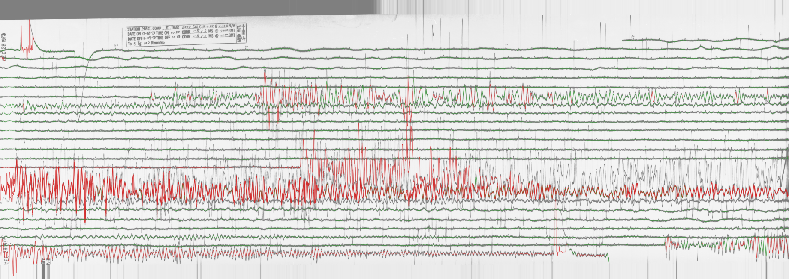
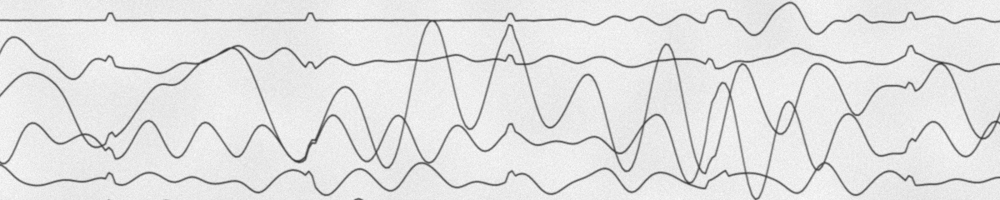
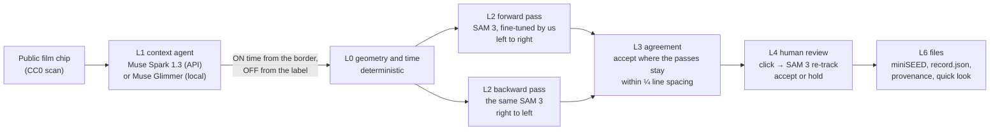
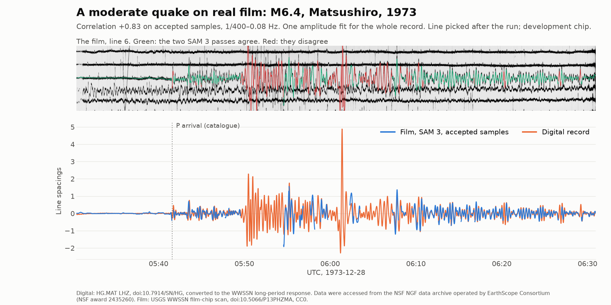
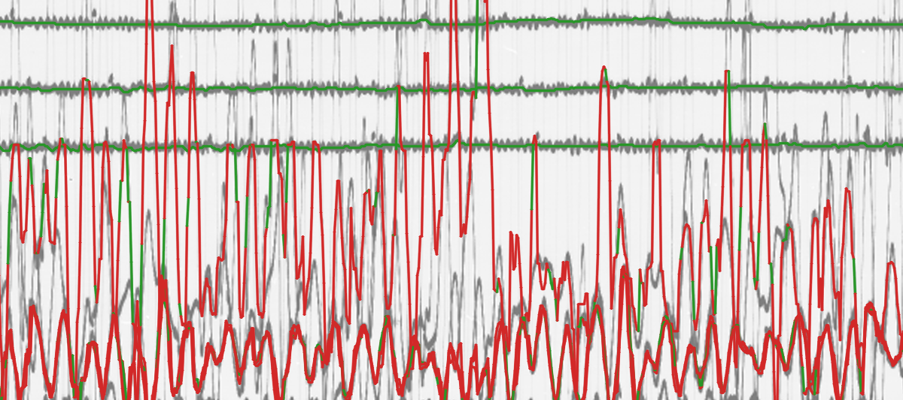
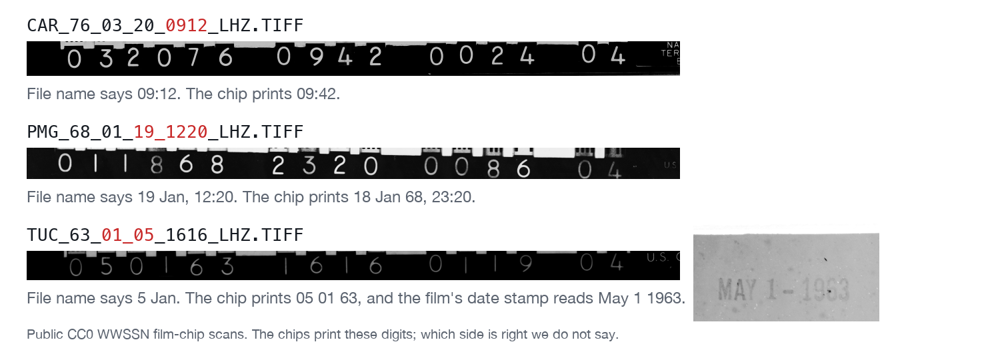
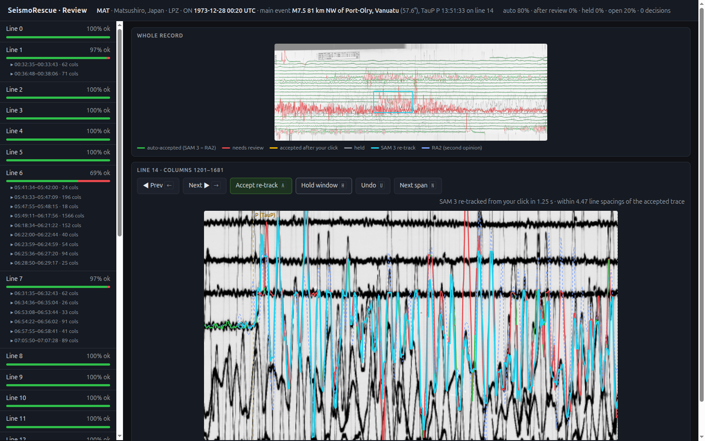
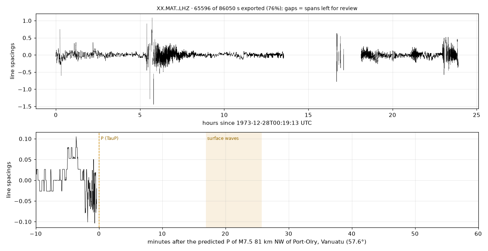

# SeismoRescue

<p align="center">
  <a href="README.md"></a>
  <a href="README.ko.md"></a>
</p>

**Reading 1970s earthquake film with Meta's SAM 3 and Muse models. Where two passes of the tracer disagree, a person decides.**

<p align="center">
  
</p>
<p align="center"><sub>Real film chip, Matsushiro (MAT), 1973-12-28, public CC0 scan. SAM 3, fine-tuned by us, traces every line twice: left to right, then right to left.<br>
🟩 auto-accepted: the two passes stay within ¼ line spacing for at least 20 columns. 🟥 disputed: sent to human review.<br>
The red spans sit on the tangled earthquake lines (14–18), a smaller quake on line 6, and the last line, where one pass lost the line. 8.5 minutes on one RTX 5070 Ti, Spark calls included; 76.1% of the record's columns accepted.</sub></p>

## Try it: no key, no GPU, no account

Needs [uv](https://docs.astral.sh/uv/) and about 1.5 GB of disk on a Mac, about 6 GB on Linux (PyTorch brings the CUDA libraries). This runs on the real 1973 chip above, on a laptop.

```bash
git clone https://github.com/smpark00/seismorescue && cd seismorescue
./setup_env.sh      # Python 3.12 venv with pinned packages
./bootstrap.sh      # puts the shipped checkpoints, results and the MAT example under out/

# 1. L0 and the agreement rule, live, on the stored SAM 3 paths. Writes overlay.png, quake.png, provenance.json
.venv/bin/python -I scripts/rescue.py data/real_scans/MAT_73_12_28_0020_LHZ.TIFF --reuse --on 1973-12-28T00:20:00 --off 1973-12-29T00:13:00

# 2. The files: miniSEED written and read back with ObsPy, export.json, quicklook.png
.venv/bin/python -I scripts/export_mseed.py export out/rescue/MAT_73_12_28_0020_LHZ

# 3. The border-reading score, from Spark's stored replies and the station table
.venv/bin/python -I scripts/l1_context.py replay
.venv/bin/python -I scripts/show_l1.py out/rescue/MAT_73_12_28_0020_LHZ      # what Spark did on this chip: requests, tool calls, replies

# 4. The review page with stored re-tracks: http://127.0.0.1:8791/ (click a trace, A accept, H hold, N next span; Ctrl-C to stop)
.venv/bin/python -I scripts/review_server.py out/rescue/MAT_73_12_28_0020_LHZ --replay
```

You should see `accepted 76.1% of trace columns`, then `65401 of 86050 s exported`, then `'all4': '25/30'`, then a page with a red **RECORDED RUN** banner. Output is in `out/rescue/MAT_73_12_28_0020_LHZ/`. On the page, try the first span of line 18: the left-to-right pass had slipped onto the big swings above it, the right-to-left pass stayed on the line and so the two disagree, and the stored re-track stays on the ink. On line 24 the stored click sits on a backward pass that had left the line, so its re-track is off the screen. A re-track is only as good as the click, which is why a person decides.

| Step | In the path above | To run it live ([Reproduce](#reproduce)) |
|---|---|---|
| L0 geometry and time, agreement rule, miniSEED, station table | **Live** | Nothing more |
| Muse Spark reads the border | Stored: `results/e4/responses/`, and every request, tool call and reply in `examples/MAT_73_12_28_0020_LHZ/l1/l1_transcript.json` | A Meta Model API key ([.env.example](.env.example)) |
| Muse Glimmer reads the border | Stored: `results/e9/responses/` | llama.cpp, 18 GB of open weights, a 16 GB GPU |
| SAM 3 traces every line, both ways | Stored: `paths.npz` | **Gated access and a GPU:** your own approved access to `facebook/sam3` (we do not redistribute the base weights) |
| SAM 3 re-tracks after a click | 66 stored re-tracks, labelled as recorded. A script made those clicks on the backward pass's path, one per review window (66 of 73: the other 7 have no path to click on or sit too close to the line's end), and we looked at only a few of them. The page shows the stored re-track of that window, not a reaction to your click | **Gated access and a GPU**, then drop `--replay` |

**What needs gated access and a GPU:** only the two SAM 3 rows. With that access, [Reproduce](#reproduce) runs the full demo in the video from this repository. Without it you get the recorded run above, and [`results/logs/`](results/logs) and [`examples/`](examples) hold the logs, traces and outputs behind it.

## In one paragraph

From 1962 to 1978 the World-Wide Standardized Seismograph Network (WWSSN) recorded the world's earthquakes on photographic paper, later copied to film chips. The USGS released the film-chip scans under CC0 in 2025. Turning a chip back into data fails exactly where it matters: the earthquake trace swings across its neighbours and crosses them hundreds of times. SeismoRescue takes one public chip and returns files: a record sheet (station, start time, the earthquake and the line it should be on), a miniSEED waveform that keeps only the spans where two passes of the tracer agree, and a review list for the rest. **Meta's SAM 3, fine-tuned by us**, traces every line from both ends and re-traces a span when a person clicks on the right stroke. **Muse Spark** reads the printed film border and calls deterministic tools. **Muse Glimmer**, Meta's open-weight model, does the same reading on our own GPU, so scans that must stay private never leave the machine. Every model called at runtime is a Meta model. The tangled earthquake line is still mostly human work. On 10 unseen earthquakes (synthetic film), accepted earthquake-line columns were within ¼ line spacing 94.2% of the time, against 72.5% for a flat line on the same columns. On real film the accepted path follows the digital record's shape on two smaller quakes (r +0.91, +0.83). On the two major quakes it does not: almost nothing is accepted on one, and on the other the accepted half scores no better than a flat line. That part goes to a person.

## At a glance

| What | Result | Data | Kind |
|---|---|---|---|
| Earthquake line, auto-accepted columns | **94.2%** within ¼ line spacing (a flat line on the same columns: 72.5%); 87.9% of columns kept | 10 unseen quakes, 95 synthetic films | test |
| Earthquake line, columns where the pen really moved | within ¼ spacing: SAM 3 forward alone 67.2%, accepted by the rule **80.6%**, on 70.8% of those columns (a flat line: 0% by definition) | same | test |
| All lines, auto-accepted columns | **97.9%** within ¼ spacing (flat line: 93.6%), **99.2%** without the minute marks, which the export bridges anyway (flat line: 95.3%); 93.9% kept | same | test |
| Real film, two smaller quakes | accepted-span r **+0.91** (ALQ 1975, Ms 6.3), **+0.83** (MAT 1973, M6.4, line picked after the fact) against the digital record | 2 chips | descriptive |
| Real film, two major quakes | MAT, M7.5: almost none of the earthquake line accepted. KIP, M7.6: 50% accepted, r −0.22, and a flat line scores better there. This is human work | 2 chips | descriptive |
| Border reading, Spark + table | **16/20** chips right against the archive's file names. On the other 4 the agent matches the chip itself, checked by eye after the test | 20 new public chips | test |
| 300 new public chips, unattended | The agent finished **297/300**. On at least **32** the file name differs from what the chip prints. L0 gave a time model on 164/297; its accuracy is not measured here | 300 new public chips | one pre-registered run, no truth for times |
| Glimmer on our GPU vs Spark | 24/30 vs 25/30 chips right | 30 public chips | descriptive |
| One click, then SAM 3 re-track | share within ¼ spacing, all lines: 42.8% → 55.8% (flat line 35.7%, backward pass 47.7%). Earthquake line: 38.3% → 48.0%, a gain not shown | synthetic development set | development |
| miniSEED timing | within about 2 s of the co-located 1973 digital record | MAT chip | development check |

"Test" means a method frozen before a single run on data it never saw. A flat line at the baseline has no skill, so it shows how much of a score comes from the ground not moving. We report it next to the position scores, and the one without it says so. Details and intervals are in [Results](#results). What does not work yet is in [Limits](#limits).

## The problem

- A WWSSN long-period chip holds about one day of ground motion: one line per hour (3588–3589 s on real film), about 24 lines, with a tick every minute.
- Quiet lines are easy. The earthquake line is not. On the two major quakes (MAT, KIP) its swing is 4.8–8.7 line spacings, so it crosses its neighbours again and again, and its steep strokes fade.
- Every line looks the same. Which stroke belongs to which line at a crossing has to come from context.

<p align="center">
  
</p>
<p align="center"><sub>Synthetic crop at 2× amplitude with 56 trace contacts. SAM 3.1 through the Meta Model API, zero-shot, returns <b>0 instances</b> here.<br>A classical tracker fails on 58% of columns (first film geometry, no flat line computed for it). This is why we fine-tune SAM 3 and trace each line from both ends.</sub></p>

## Prior work

People digitized these records by hand for decades ([Okal 2015](https://www.earth.northwestern.edu/people/emile/PDF/EAO234.pdf)); digitizing the 1964 Alaska data set took two years ([Eos 2016](https://eos.org/articles/adam-m-dziewonski-1936-2016)). Software has helped since at least 2003, but a person still checks its work where lines cross:

| Work | What it does | Where lines cross |
|---|---|---|
| SeisDig ([user manual, 2003](https://www.ncedc.org/ftp/pub/assembled/BSL_Scanned_Seismogram/software/UsersManual.pdf)) | Digitizes scanned seismograms | Its tracker follows many intersections; errors there are found by visual inspection and edited by hand |
| Teseo / Teseo2 (Pintore et al., C&G 2005; [poster](https://teseo.rm.ingv.it/docs/posters/poster_ssa.pdf)) | Semi-automatic tracing, a GIMP plug-in | The user steers the tracer by clicking |
| DigitSeis (Bogiatzis & Ishii, SRL 2016; [Ishii & Ishii, PEPS 2022](https://doi.org/10.1186/s40645-022-00508-0)) | Digitizer; the USGS release page points to it | Separated through user intervention |
| SKATE ([User Manual v1.0, 2023](https://docs.google.com/document/d/1kB97u-sA2uIJpcT2G10AjCUcVVNj6AMdwsitGrD8akw/export?format=pdf)) | Pipeline built for WWSSN chips | Tracks across crossings automatically "when there is significant seismic activity"; a person still removes spurious features; the manual gives no accuracy |
| SEISMOSTORM ([BELSPO final report, 2024](https://www.belspo.be/Belspo/brain2-be/projects/FinalReports/SEISMOSTORM_FinRep.pdf)) | Digitizes a Belgian archive to MiniSEED | Crossing lines are ignored |
| U-Net ([Zhao, Ishii et al., EGU 2020](https://meetingorganizer.copernicus.org/EGU2020/EGU2020-4294.html)); CNN at JMA ([Furumura et al., SRL 2023](https://doi.org/10.1785/0220230008)) | Learned trace extraction | U-Net reports no results at crossings; the CNN does not cover long-period large amplitudes |
| Wang et al., SRL, online 2024 ([doi:10.1785/0220240220](https://doi.org/10.1785/0220240220)) | Automatic digitizer; YOLOv9s removes the time marks | Not checked by us |
| [Walker & Soto-Cordero, CTBT SnT 2025](https://conferences.ctbto.org/event/30/contributions/5760/attachments/3245/6512/P2.4-066_Walker.pdf) | Synthetic helicorder generator; tested Teseo, DigitSeis and SKATE on a 12-minute trace | Crossings not part of that test; current options "require careful user oversight"; paired real truth does not exist for historic records |
| SARNet ([Nagle-McNaughton et al., SRL 2022](https://pubs.usgs.gov/publication/70231381)) | A CNN that ranks 34,000 WWSSN chip scans for review | Not a digitizer |
| [Agrawal et al., SRL 2026](https://pubs.usgs.gov/publication/70277088) | A language model extracts data from legacy text reports of shaking | Text, not film images |
| Kalal et al., ICPR 2010 | Forward-backward error to flag tracker failures | Our two-pass agreement uses the same idea |

**What is new here, as far as we could find:** Segment Anything fine-tuned for film seismograms (on simulated film), and language models (Muse Spark, Muse Glimmer) reading the chips' printed borders. A project upgrading SKATE is applying other machine learning to the chips' dogtag and metadata ([Díaz et al., CTBT SnT 2025](https://conferences.ctbto.org/event/30/contributions/5759/attachments/3011/5825/P2.4-427_Hwang%20FINAL.pdf)). We have not run any of these tools on our data, so we claim no gain over them. Our comparisons are against baselines we ran: zero-shot SAM 3.1, one pass, and a flat line.

## What it does



| Layer | What it does | Model |
|---|---|---|
| **L0** geometry and time | Finds the record area and polarity, levels the lines and finds their baselines. Measures pixels per second and the line period from the minute ticks. Sets the ON time at the first minute tick after the trace starts. Result: a UTC time for every pixel. | none (deterministic) |
| **L1** context agent | Reads the 16 printed border digits (ON date, ON time, station number, component code) and the label. Calls four tools: `decode_border` (station-number table), `station_by_code`, `measure_record` (runs L0 with the times it read), `catalog` (USGS earthquake catalogue + TauP → the line where the main quake should appear, ±1). Every number in the record comes from a tool, except the label fields it reads (magnification, OFF time). | **Muse Spark 1.3**; Muse Glimmer for local-only reading |
| **L2** tracing | Traces every line twice with the same model: forward from the left edge, and backward on the mirrored image from the right edge. Both passes start from L0's baselines. | **SAM 3, fine-tuned** |
| **L3** agreement | Per column: accept if the two passes are within ¼ line spacing (about 9.5 px) for at least 20 columns in a row, else dispute. The value exported is the forward pass. The rule was chosen once on a development set and then frozen. | none (frozen rule) |
| **L4** human review | A local web page zooms into each disputed span. The person clicks the right stroke. SAM 3 re-traces from that point (about 1 s on an RTX 5070 Ti, about 4–5 s on a laptop's Apple GPU). The person accepts (A) or holds (H). | **SAM 3** (same checkpoint, point prompt) |
| L5 checks | Physics checks (line seams, P pick vs TauP). | not built yet |
| **L6** files | Writes accepted and human-confirmed samples at 1 Hz on L0's time model. Everything else is a gap. | none |

**The product is the files.** The review page is a tool to make them.

| File | Contents |
|---|---|
| `l1/record.json`, `l1/l1_transcript.json` | Station, component, ON/OFF, magnification, main quake and its predicted lines, flags, cost; every request, tool call and reply |
| `overlay.png`, `quake.png` | Green/red view of the whole record and of the line with the widest swings |
| `paths.npz`, `provenance.json` | Both passes' paths; per line the accepted share and the review spans in UTC; model and rule hashes |
| `review/decisions.json` | Every human decision: line, columns, UTC, click, accepted path, model hash, tied to the hash of `paths.npz` |
| `export/XX.<STA>..LHZ.mseed` | Rescued trace, FLOAT32, 1 Hz, gaps where review is open |
| `export/export.json`, `export/quicklook.png` | Input hashes, sample counts by source, gaps, time model, read-back check |

## Meta models

| Model | How we run it | Role | Key result |
|---|---|---|---|
| **SAM 3** (860 M parameters in the released checkpoint, of which the tracker we run uses 457 M; open weights, gated on Hugging Face), **fine-tuned by us** | LoRA (rank 8) on the last 16 of 32 backbone blocks, with the FPN neck and mask decoder also trained. 60 min on one Modal H100. Training images come from our calibrated film renderer ("film2"). Inference on an RTX 5070 Ti (forward pass of ALQ 1975: Modal H100). | L2 tracer, both passes. L4 click re-tracker, using SAM's point prompt. | Synthetic test: earthquake-line r 0.865 on all 95 images. On the 91 images with at least 200 accepted columns: 0.893 on the whole line, 0.952 on accepted columns. Fine-tuning takes earthquake-line failures from 62.7% to 20.5% of columns (film2 validation; a flat line scores 28.7% on this easy metric). |
| **Muse Spark 1.3** (`muse-spark-1.3-contributor`, Meta Model API) | Live API calls. Budget per chip: 6 requests, 6 tool calls, 1 retry. Replies are validated (required keys, formats, the border must decode). | L1 agent: reads the border and label, calls the tools, picks the main quake. | 16/20 new chips right by file names; the other 4 match the chip, checked after the test. $0.071 for 20 chips. |
| **Muse Glimmer** (open weights, Apache 2.0) | llama.cpp on the same 16 GB GPU, partly on the CPU. Not fine-tuned. | L1 reader where a scan must not leave the machine. | Reads the border as well as Spark: 24/30 vs 25/30. |

**Every model called at runtime is a Meta model.** L0, L3 and L6 are deterministic code.

### Where and how Muse Glimmer is used

- **Model:** `Muse-Glimmer-30B-KQuant-17GB-Q4_K_M.gguf` (16.8 GB) and its vision projector (1.4 GB), from the Hugging Face repo `meta-models/Muse-Glimmer-30B-GGUF`. We use the weights as released.
- **Where:** `llama-server` (llama.cpp, built with CUDA) on our workstation. 14.8 GB of layers sit on the RTX 5070 Ti; the rest run on the CPU. It listens on localhost only. No API is called.
- **What it does:** the L1 reading step. It gets the same two images and the same fixed question as Spark (the whole chip, and the top 35% where the border digits and label are). Its border digits go through the same station-number table. Settings: temperature 0, reasoning "medium", at most 4096 tokens.
- **Result (30 public chips, run once):** with the table, 24/30 chips fully right, against 25/30 for Spark. About 2 minutes per chip (median 134 s), $0.
- **Why it matters:** Spark's contributor tier lets Meta use inputs for training, so we send it public CC0 chips only. Glimmer gives the same reading for scans that may not be shared. So far we have run it on public chips only.
- **In this version** Glimmer does the one-shot reading; the multi-turn tool-calling loop runs on Spark.

### What we tried that did not work

- **Zero-shot SAM 3.1** (Meta Model API) returns no instances in crops where lines touch 56–212 times.
- **Spark as a crossing judge** fixed 34 cases and broke 60. **Spark as a seismologist agent** did not beat simple rules (P within 10 s: 0.67 vs 0.71). So Spark reads and chooses; tools measure.
- Our first fine-tune was **SAM 2.1** (tiny, on a laptop). SAM 3 did better on unseen earthquakes (r 0.848 vs 0.802, +0.045 [+0.015, +0.079], earlier renderer), and a control run showed the gap is not explained by training length. SAM 3 is the core model now.
- **Fine-tuning Muse Glimmer as a line-identity judge.** QLoRA itself worked: 4-bit on one Modal H100, 20 steps, about $0.60, and the saved adapter reloaded with identical logits. On a synthetic A/B task (which red path stays on the quake line through a crossing), accuracy rose from 0.56 to 0.98 on 200 validation crops. With the film ink erased from the same crops it still scored 0.985, so the model had learned the shape of the red paths, not the film. We do not use this adapter. The no-ink control is what caught it. The adapter is published for transparency in the release [glimmer-qlora-test](https://github.com/smpark00/seismorescue/releases/tag/glimmer-qlora-test) (Apache 2.0, like Muse Glimmer).

## Results

S is one line spacing (38 px). Square brackets are 95% intervals from a bootstrap over earthquakes (10,000 draws) unless noted.

### 1. Auto-accept on unseen earthquakes (synthetic film, test)

Fresh holdout: 10 earthquakes (M7.5–8.8) on days not used anywhere before, 19 records × 5 amplitudes = 95 film images from the calibrated renderer. One of 20 planned records could not be downloaded; we did not replace it. The rule and the code were frozen, and the test ran once.

| Lines | Auto-accepted | Precision (within S/4) | Flat line, same columns | SAM 3 forward alone, all columns | Errors sent to review |
|---|---|---|---|---|---|
| Earthquake line | **87.9%** [78.9, 93.1] | **94.2%** [92.8, 95.3] | **72.5%** [68.2, 76.2] | 87.5% (flat line 65.8%) | 58.9% [42.8, 74.4] |
| All lines | **93.9%** [84.6, 98.8] | **97.9%** [97.5, 98.3] | **93.6%** [91.8, 94.7] | 94.1% (flat line 89.5%) | 67.2% [21.7, 84.7] |

Agreement between the passes has real skill: on the earthquake line the accepted columns beat the flat line by 21.7 points [18.6, 25.0].

**Minute marks.** The pen jumps up for a few seconds every minute. Neither pass follows these ticks, so they are most of the remaining error on quiet lines. Our export bridges those seconds anyway (99.8% of these columns on this test set; on real film it depends on L0's clock). Leaving out the columns where the pen is more than 0.1 S from the signal (3.8% of them), precision is **95.1%** [93.6, 96.3] on the earthquake line and **99.2%** [98.8, 99.5] on all lines, against 73.6% and 95.3% for the flat line.

A flat line at the baseline scores high here because the pen is near its baseline on most columns. So we also score only the columns where the pen really moved, more than S/4 from its baseline. A flat line gets 0% of these by definition.

| Columns where the pen moved | Share of columns | Forward alone, within S/4 | Accepted by the rule | Accepted, within S/4 | Same, without minute marks |
|---|---|---|---|---|---|
| Earthquake line | 34.2% | 67.2% [55.4, 74.9] | 70.8% [56.2, 80.4] | **80.6%** [77.8, 83.1] | 83.1% [80.2, 85.9] |
| All lines | 10.5% | 51.6% [39.7, 67.2] | 57.5% [35.4, 86.6] | **69.6%** [65.7, 73.7] | 85.7% [83.3, 87.8] |

So the rule has real skill where the pen moves, and it does not reach 95% there: about one in five accepted earthquake-line columns of this kind is wrong. The rest goes to a person.

| Amplitude (×) | Earthquake line: accepted / precision (flat line) / without marks (flat line) | All lines: accepted / precision (flat line) / without marks (flat line) |
|---|---|---|
| 1 | 99.8 / 98.2 (88.5) / 99.6 (90.5) | 100.0 / 98.3 (94.8) / 99.9 (97.1) |
| 2 | 94.9 / 96.4 (81.3) / 97.1 (82.3) | 95.6 / 98.5 (95.6) / 99.3 (96.9) |
| 4 | 89.5 / 93.9 (69.0) / 94.8 (70.0) | 94.0 / 97.9 (93.6) / 99.2 (95.3) |
| 6 | 81.3 / 92.9 (62.8) / 93.8 (63.7) | 91.4 / 97.7 (92.3) / 99.1 (94.0) |
| 8 | 74.0 / 87.7 (54.3) / 88.4 (55.0) | 88.7 / 97.3 (91.2) / 98.6 (93.0) |

- 5.8% [4.7, 7.2] of accepted earthquake-line columns are wrong (a flat line: 27.5% of the same columns): both passes made the same mistake. They are the same model, so their errors line up more easily than those of two models.
- The rule (within ¼ line spacing, at least 20 columns in a row) was chosen once on a separate development set of 10 other earthquakes, among 24 candidates, with the targets ≥ 95% on the earthquake line and ≥ 99% on all lines. **We changed how the targets are scored after seeing the development set, before the test:** on the first try no candidate met them, because of the minute marks, so the targets are measured without those columns. The change, its reason and the fallback rule it replaced are in [results/both_directions](results/both_directions/README.md). The development numbers were 84.9% / 94.2% on the earthquake line and 96.9% / 97.8% on all lines (flat line on the same columns: 72.7% and 93.2%). The test numbers above stayed close to these.

### 2. The two passes on their own (synthetic, test)

| Earthquake-line r | Forward | Backward | Accepted columns only |
|---|---|---|---|
| 10 test quakes, 95 images | 0.865 | 0.864 | **0.952**, on the 91 images with at least 200 accepted columns (forward alone on those 91: 0.893) |

Neither direction is better on average. They fail in different places: a pass that slips onto another line tends to stay there, and the two passes reach that place from opposite sides. That is why L3 asks them to agree.

### 3. Real film: shape against the digital record (descriptive)

We scored the frozen system on three real chips that have a digital station at the same site: MAT (1973-12-28, M7.5), KIP (1975-02-02, M7.6) and ALQ (1975-10-28, Ms 6.3). r is measured in 1/400–0.08 Hz. Position errors are measured after a low-pass filter, one global amplitude fit and a per-line offset and trend fit. **r is the primary metric here**, because a flat line has no r. The position columns show a flat line next to SAM 3, on the same masks with the same fit. Each cell is accepted / flagged.

| Record, lines | Accepted share | r | Off by > S/2: SAM 3 | Off by > S/2: flat line | Within 0.1 S: SAM 3 | Within 0.1 S: flat line |
|---|---|---|---|---|---|---|
| MAT, earthquake line | 0.0% | – / +0.02 | – / 57% | – / 55% | – / 15% | – / 33% |
| MAT, lines next to it | 53% | +0.08 / 0.00 | 0% / 78% | 0% / 76% | 100% / 5% | 100% / 5% |
| MAT, other active lines | 70% | +0.69 / +0.43 | 5% / 33% | 3% / 38% | 63% / 20% | 62% / 20% |
| MAT, quiet lines | 99.8% | +0.28 / – | 0% / – | 0% / – | 95% / – | 99% / – |
| KIP, earthquake line | 50% | −0.22 / +0.24 | 10% / 72% | 7% / 68% | 29% / 6% | 89% / 7% |
| KIP, lines next to it | 50% | +0.17 / +0.11 | 0% / 75% | 0% / 75% | 79% / 4% | 79% / 4% |
| KIP, other active lines | 60% | +0.35 / +0.01 | 6% / 27% | 7% / 27% | 62% / 42% | 61% / 43% |
| KIP, quiet lines | 94% | +0.05 / −0.06 | 0% / 11% | 0% / 0% | 100% / 80% | 100% / 100% |
| ALQ, earthquake line | 91% | **+0.91** / +0.68 | **0% / 39%** | 9% / 66% | **70% / 20%** | 43% / 8% |
| ALQ, lines next to it | 99% | +0.79 / – | 0% / – | 2% / – | 91% / – | 78% / – |
| ALQ, other active lines | 66% | +0.66 / +0.04 | 0% / 42% | 1% / 3% | 91% / 22% | 83% / 78% |
| ALQ, quiet lines | 93% | +0.11 / −0.07 | 0% / 0% | 0% / 0% | 100% / 75% | 100% / 100% |

- **On the two major quakes we do not have a waveform.** On MAT the two passes disagree along almost the whole earthquake line, so almost none of it is accepted (0.0% in this frame, 0.7% in the product run). On KIP half of it is accepted, mostly where the ground barely moved: the digital record's median motion is 0.03 S on accepted samples and 0.90 S on flagged ones. There r is −0.22 and a flat line scores better (within 0.1 S: 89% vs 29%). So the gap between accepted and flagged says where the ground moved, not that the tracer read it.
- **On ALQ, a smaller and less tangled quake, SAM 3 beats the flat line and follows the long-period shape, but not the full amplitude:** r +0.75 on the whole line, +0.91 where accepted, on a chip not used to build the model or the rule. Time alignment and sign were fitted to this same digital record with a classical tracker, not SAM 3; leaving the earthquake line and the lines next to it out of that fit gives r +0.76. Circular shifts and phase scrambles reach at most 0.30, and a side peak of the lag scan reaches 0.47. Limits: one chip, a small event, amplitude slope 0.55, and other chips from this station were used to calibrate the renderer.
- **On MAT, a smaller quake on the same chip (M6.4, line 6) gives r +0.83 on accepted samples** (+0.68 on the whole line, 73% accepted). We picked this line after the run, because it holds that quake, and MAT is a development chip. We then tried to break it, with pass rules written down first, and it held: the best lag within ±600 s is +1 s (r +0.85; at most 0.31 beyond ±30 s), 1,500 circular shifts of at least 600 s reach at most 0.19, 2,000 phase scrambles at most 0.23, the reference of any other line at most 0.06. In 600 s windows, r is −0.27 before the quake, +0.42 in the window where the P wave arrives, and +0.94, +0.89 during it. Lines 18 and 17 score about the same (+0.83, +0.79), so this is not a lone peak.
- **SAM 3 can slip onto another line and stay there** (three lines on ALQ). The backward pass disagreed each time, and the rule refused them (almost none accepted). The S/2 and 0.1 S columns remove a per-line offset and trend, so a path that stays on the wrong line can still score well, and a partial slip can make good samples look bad. r helps only on lines with signal. We saw the same pattern on MAT and KIP but have not confirmed it there.
- KIP is a local copy. We publish its numbers only, never its image.

<p align="center">
  
</p>
<p align="center"><sub>MAT line 6 (M6.4), after the run. The accepted samples follow the digital record, and the largest swings are flagged, so they have no film trace here. Drawn by <code>scripts/fig_mat6.py</code>.</sub></p>

<p align="center">
  
</p>
<p align="center"><sub>MAT, zoom on the line with the widest swings (line 14, accepted 0.7% in the product run). Red is where the two passes disagree.</sub></p>

### 4. Reading the film border (Muse Spark, real public chips)

| | Spark reads the label alone | Spark's border digits + station table | Full L1 agent |
|---|---|---|---|
| Chips | 30 public chips (E4) | same 30 replies, re-decoded | 20 new public chips (E7) |
| All four fields right, vs file names | 12/30 (40%) [25, 58] | 25/30 (83%) | **16/20 (80%)** [58.4, 91.9] |
| All four fields right, vs the chip itself, checked after the test | 13/30 | 27/30 | **20/20** |
| Cost | $0.034 | $0 (no new calls) | $0.071 |

- The four fields are station, ON date, ON time and component. The pre-registered truth was the archive's file name. Intervals here are Wilson 95% intervals.
- Spark read all 16 border digits on 29 of 30 chips. Station codes in handwriting were the weak part (15/30). So L1 asks Spark for the digits, and a table turns them into station and component.
- The station table covers 96 WWSSN stations. It comes from 23 archived IRIS Seismo-Archives pages. Two chips used station numbers not in the table; we do not guess them.
- **On these 50 chips (E4 and E7) the archive's file names differ from what is printed on the chip on 6 (12%).** On all 4 E7 mismatches the agent matched the chip's border and label (e.g. a chip whose label says PTO, filed as QUI). Our AI assistant checked this by eye after the test, not an independent person; the list is in [results/e7/chip_checks.json](results/e7/chip_checks.json). The product treats the chip as the primary source and flags a mismatch.
- The agent finished within budget on 20/20 chips. Median 117 s per chip, with L0 inside.
- **Placing the quake on the right line works when the line count is right.** On the MAT chip it predicts line 14, as in the digital record. On the new chips the side check scored 3/9 (random: about 13%). A look after the test traced the misses to L0's line counting and to a weak check metric, not to the agent.

### 4b. 300 new public chips, unattended

The frozen L0 and L1 ran once, with nobody watching, on 300 chips we had not seen: a seeded random walk of the public long-period vertical chips, at most 4 per station, 105 stations. We set no pass or fail thresholds. These chips have no ground-truth times, so this run says nothing about time accuracy. Details and the lists are in [results/a1/](results/a1/README.md).

| | 300 new chips | Wilson 95% |
|---|---|---|
| Agent finished with a valid answer | **297/300** (99.0%), one retry | [97.1, 99.7] |
| Agent's value differs from the file name | 45/297 (15.2%) | [11.5, 19.7] |
| Checked on the chip: the file name differs from what it prints | **at least 32/297** (10.8%) | [7.7, 14.8] |
| L0 supports the line format (one line per hour) | 167/297 (56.2%) | [50.5, 61.8] |
| L0 builds a time model | 164/297 (55.2%) | [49.5, 60.8] |
| L0 flags another format / finds no minute marks / layout fails | 72 / 27 / 31 of 297 | |
| L0's line-count check disagrees, where it could be made | 78/113 (69.0%) | [60.0, 76.8] |
| Widest-swing line within ±1 of the predicted line (a weak check) | 40/123 (32.5%) | [24.9, 41.2] |
| Cost, median time per chip | $1.06, 113.5 s | |

<p align="center">
  
</p>

- **How the 32 were checked.** Two Claude sessions read the 45 flagged chips without seeing the file names, Spark's reads or each other's answers, and a script compared their readings with the names. They are not independent people. 32 differ, 8 are Spark's misreads, 5 are unclear. The pre-registered sample of 30 gave 23, an estimate of 34.5 chips; we also read the other 15. We fixed one script bug after seeing the results, which moved 4 chips to "differs", 3 of them in the sample (from 20 to 23, estimate 30.0 to 34.5; [details](results/a1/README.md)).
- **We say the name differs from the prints, not which is right.** Some look like a swapped month and day: chips filed as `63_01_05` carry the film stamp May 1 1963.
- **The agent makes mistakes too.** At least 8 of its 45 flags are its own misreads, mostly handwritten station codes. On one underexposed border it reported digits that are not visible.
- **L0 is the weak part on new chips.** On 130 of 297 (43.8%) it found no line format it supports. All 4 chips it read as negatives are positives; none produced times. Three chips failed outright, one because the file is truncated in the archive.

### 5. Muse Glimmer, local, against Spark (same 30 chips, same question)

| All four fields right (30 chips) | Glimmer (local, $0) | Spark (API) |
|---|---|---|
| Label reading only | 6/30 | 12/30 |
| **Border + station table** | **24/30** [62.7, 90.5] (Wilson) | 25/30 |
| Border + table, checked on the chip | 26/30 | 27/30 |
| All 16 border digits read | 28/30 | 29/30 |
| Time per chip (median) | 134 s | 34 s |

Glimmer is weaker on handwriting but almost equal on the printed border. The single extra miss (ANP_69) hit the 4,096-token reasoning limit twice and gave no answer.

### 6. Human review: one click, then SAM 3 re-tracks (synthetic, development)

A simulated reviewer clicked once on the true stroke in each review window (363 windows, 86,512 disputed columns). This is the development set used to choose the rule, so these are development numbers.

| Share within S/4, disputed columns inside review windows | All lines | Earthquake line |
|---|---|---|
| **SAM 3 re-track after the click** | **55.8%** [46.4, 64.4] | **48.0%** [36.9, 59.6] |
| Forward pass, same columns | 42.8% | 38.3% |
| Backward pass, same columns | 47.7% | 47.2% |
| Flat line, same columns | 35.7% | 27.1% |

- Review windows hold 97.0% of all disputed columns (97.7% on the earthquake line).
- The gain over the forward pass is shown on all lines (paired difference +13.0 points [+1.4, +21.8]) but not on the earthquake line (+9.7 [−5.0, +23.2]). Against the backward pass on the same columns no difference was shown (+8.1 [−1.0, +19.0] and +0.9 [−6.1, +6.2]).
- The page warns when a re-track leaves the accepted columns by more than 0.25 S. Windows without a warning are about a third of all windows (31%); their columns are 69% right (40% with a warning), and a flat line gets 54% and 14% of the same columns.
- A ±3 px click error did not change the result (55.3%; flat line 35.7%).
- Accepting every re-track blindly would cover 99.6% of the earthquake line but drop precision from 94.2% to 87.3% (a flat line on those columns: 72.7% to 66.0%). **So every re-track is shown to the person, who accepts or holds it.**

<p align="center">
  
</p>
<p align="center"><sub>The review page runs on this computer only (127.0.0.1). Forward pass coloured by state, backward pass dashed, re-track candidate in light blue.</sub></p>

### 7. Time and files

- **L0 timing without ground truth (test):** on a held-out 1973 Albuquerque (ALQ) chip with a co-located digital record, never opened while L0 was developed (it was used earlier to calibrate the film renderer), every line's time was within 3.03 s (median −1.6 s). Pixels per second were off by +0.05%; the line period came out 3588.05 s against 3588.0 s. On the development chip MAT, all lines are within 4 s. (ALQ is a local copy; numbers only.)
- **miniSEED (MAT, development chip):** 65,401 of 86,050 s (76.0%) exported in 76 segments; read back with ObsPy with zero difference.
- **Timing against the 1973 digital record:** best lag +2 s (r 0.53; +1 s gives 0.52; 1/400–0.08 Hz, 16.8 hours of accepted trace in 4 segments over 15 minutes). Two segments hold the signal (+2 s, r 0.74; +1 s, r 0.63); the other two are quiet and have no peak. The film clock looks 1–2 s early; the minute-tick footprint, which peaks at :59, points the same way.

<p align="center">
  
</p>
<p align="center"><sub>Exported trace of the MAT chip before review. The gap from about 13 to 18 h is the tangled earthquake lines: only a few short spans are accepted there, which is why the lower panel, around the predicted P, is nearly empty.</sub></p>

### 8. SeismoBench: score your own tracer

We publish the tracing task as a benchmark: 285 synthetic film images with exact truth, a scorer that needs only NumPy, and our baselines, including a flat line. The table is in [LEADERBOARD.md](LEADERBOARD.md); [bench/README.md](bench/README.md) says how to enter. The truth is public, so scores rest on trust, and there are no outside participants so far. On the main split, our classical tracker scores below a flat line (23.0% vs 65.8% within ¼ spacing on the earthquake line).

## Limits

- **The tangled earthquake line of a major quake is still mostly human work.** On MAT almost none of it is accepted. On KIP half is, where the ground barely moved, and those spans score no better than a flat line (r −0.22). SAM 3's earthquake-line r is 0.21 (KIP, M7.6) and 0.02 (MAT, M7.5); chance is about 0.06. The +0.75 on ALQ is one smaller quake (Ms 6.3), and its amplitude is low (slope 0.55).
- **The click does not fix everything.** On the synthetic development set, accepting every re-track blindly would cut earthquake-line precision from 94.2% to 87.3% (flat line: 72.7% to 66.0%), and on those columns the re-track (48.0%) is about as good as the backward pass alone (47.2%).
- **Supported chips: WWSSN long-period film with one line per hour.** That is not the whole scanned collection of about 189,000 chips. On 300 new chips, L0 found that format on 167 of 297.
- **L0's automatic mode first failed on the ALQ 1975 chip:** it read the mid-grey paper as a negative. We fixed the polarity test during development, so the chip now completes unattended, with all 25 lines and time within 4.0 s of the fitted alignment (median −1.4 s). That is a regression check on a development chip, not a test. The real-film table above used the area and polarity given by hand. On 300 new chips the same test read 4 chips as negatives, and all 4 are positives.
- **Paths depend on the crop.** A small change in area or layout makes SAM 3 slip on different lines. On MAT the product run and the evaluation frame differ this way: line 18 is 0.0% accepted in one and 98.4% in the other, because their layouts differ. The real-film table uses the evaluation frame, the overlay at the top the product run.
- **Precision is measured on synthetic film.** Real-film precision is unknown. Both passes are one model that learned from synthetic film, so they can agree and still be wrong.
- **Two passes of one model are not two opinions.** They start from different ends, but they share weights, training data and blind spots.
- **One slip costs a long span.** A pass that slips onto another line tends to stay there, so the columns behind the slip are disputed even where the other pass is right and the ground is quiet. On MAT, line 14 is 0.7% accepted, although its forward pass stays on the baseline until the quake arrives.
- **The minute marks are not traced.** Neither pass follows the pen's ticks. They count as errors in the tables unless stated, and the export bridges those seconds with a straight line.
- **Large swings miss the targets:** from 4× amplitude up, earthquake-line precision is below 95% even without the minute marks (88.4% at 8×; flat line 55.0%).
- **L0 line counting on unseen chips is not robust.** Spurious lines near the label, records longer than 24 h, and an unread OFF time shift the line numbers. Until this is fixed, treat a predicted quake line as uncertain when L0's own checks disagree, as they did on 8 of 13 new chips, and on 78 of the 113 chips where the check could be made in the run of 300.
- **30-minute-line chips are not supported.** In a random sample of 30 public long-period chips, 10 used this format. L0 flags them and gives no times. Automatic layout failed on 3 of those 30 chips and on one paired record (KON73B). In the run of 300, L0 flagged 72 of 297 as another format; some of those may be hour-per-line chips it mismeasured.
- **The ON-tick rule was checked on three records only.** Another station or operator may differ by one minute.
- **Amplitudes are in line spacings.** No instrument correction. The per-line median is removed, which leaves small steps at line seams (median 0.049 S). No StationXML yet.
- **Development vs test.** Test numbers: the auto-accept table (10 unseen quakes, run once), border reading on 20 new chips, and L0 on the held-out 1973 ALQ chip. Development or descriptive numbers: the rule choice, the click experiment, the Glimmer comparison, real film, the MAT timing check, and the run of 300 new chips (one run, no thresholds, no ground-truth times). MAT and KIP have been used by many methods. The ALQ 1975 long-period chip was not used to build the model or the rule; it is now a development chip for L0, so L0 results on it are not held out. Other ALQ chips were used for renderer calibration and label-reading development.
- The click re-track only runs to the right and needs 256 columns before the line end. A re-tracked span is not checked again by the backward pass.

## Evaluation protocol

- **What backs the recorded run:** [`examples/MAT_73_12_28_0020_LHZ/`](examples/MAT_73_12_28_0020_LHZ) holds `l1/l1_transcript.json` (every request, tool call and reply), `provenance.json` (model and rule hashes, per-line results), `paths.npz` (both passes) and `review/recorded_retracks.json` (the stored re-tracks). [`results/logs/`](results/logs) holds the run logs, and each test's start marker (for example [`results/both_directions/holdout7_started.json`](results/both_directions/holdout7_started.json)) records the time and code hashes before its first image.
- **Exact ground truth** for synthetic film: the renderer stores the pen centreline of every line.
- **Splits by earthquake.** The same quake never appears in training and test.
- **Frozen, then run once.** Each test writes a start marker and refuses a second run. The pre-registration text and code hashes are logged before the run. Failures are reported as they came out. Since the test, `ml_sam3.py` gained a help message for missing weights and `real_paired_eval.py` a named constant, so those two hashes in the marker no longer match the files here; neither change affects a result.
- **Separate re-computation.** A second pass (another AI agent) re-implemented each metric from its definition, working from the stored paths and truth, without running a model. It matched 4,835 values for the rule choice, 1,552 for the test and an earlier holdout ([holdout6 in LEADERBOARD.md](LEADERBOARD.md#holdout6)), 1,142 for real film and 3,813 for the click experiment, none differing beyond rounding, and its own bootstrap came within 0.4 points of the intervals here. It also checked this README against the files and found five rounding slips, now fixed. An earlier pass matched the 210 per-chip verdicts of the Spark reading. The re-tracks themselves were not re-run on a GPU in this pass.
- **Real ground truth.** The digital records of MAT, KIP and ALQ are converted to the WWSSN long-period response. The scan-to-time alignment was fitted to the same digital record with a classical tracker and stored before SAM 3 ran on the chip. Chance |r| on real film is about 0.06–0.07.

## Reproduce

The no-key path is [at the top](#try-it-no-key-no-gpu-no-account). This is the live path. It needs what the table there lists.

```bash
./setup_env.sh && ./bootstrap.sh     # Python 3.12 venv with pinned packages (needs uv); shipped checkpoints go under out/

# SAM 3 base weights (gated by Meta): request access at https://huggingface.co/facebook/sam3 , then download once
.venv/bin/hf auth login
.venv/bin/hf download facebook/sam3 config.json model.safetensors --revision 3c879f39826c281e95690f02c7821c4de09afae7

# 1. One public chip end to end: L1 -> L0 -> L2 -> L3          [GPU; a Meta Model API key for --l1]
export MODEL_API_KEY=...             # read from the environment, never printed. See .env.example
HF_HUB_OFFLINE=1 .venv/bin/python -I scripts/rescue.py data/real_scans/MAT_73_12_28_0020_LHZ.TIFF --l1
#    without --l1 no key is needed: give the label times with --on / --off (ISO)

# 2. Review page, this computer only: http://127.0.0.1:8791/    [GPU, about 2 GB; no key]
HF_HUB_OFFLINE=1 .venv/bin/python -I scripts/review_server.py out/rescue/MAT_73_12_28_0020_LHZ

# 3. Files: miniSEED + export.json + quicklook.png               [CPU only]
.venv/bin/python -I scripts/export_mseed.py export out/rescue/MAT_73_12_28_0020_LHZ

# 4. Muse Glimmer, local                                          [GPU 16 GB + CPU; no key, no network]
#    first build llama.cpp with CUDA, and download the two GGUF files from meta-models/Muse-Glimmer-30B-GGUF into models/muse-glimmer
llama.cpp/build/bin/llama-server -m models/muse-glimmer/Muse-Glimmer-30B-KQuant-17GB-Q4_K_M.gguf \
  --mmproj models/muse-glimmer/mmproj-Muse-Glimmer-30B-Q4_K_M.gguf -c 16384 -fit on --jinja -np 1 --port 8792
.venv/bin/python -I scripts/e9_glimmer_labels.py dev     # the MAT chip, and the ALQ 1975 SHZ chip if you fetched it (data/README.md)
```

Step 1 took 8.5 minutes on an RTX 5070 Ti. Expect about four times that on an Apple-silicon laptop (our estimate: an earlier version with one SAM 3 pass took 9.5 minutes there against 143 s). The scored paths come from NVIDIA GPUs (RTX 5070 Ti, Modal H100): Apple GPUs give slightly different SAM 3 paths.

| Experiment | Command | Needs |
|---|---|---|
| Fetch the 30 + 20 public chips | `scripts/fetch_e4_chips.py data/e4_chips` (E7 options in its docstring) | network (EarthScope) |
| Spark label reading (E4) | `scripts/e4_spark_labels.py run`, then `score` | `MODEL_API_KEY` |
| Border + table replay | `scripts/l1_context.py replay` | nothing |
| L1 agent on 20 new chips (E7) | `scripts/l1_context.py test`, then `score` | `MODEL_API_KEY` |
| Glimmer reading (E9) | `scripts/e9_glimmer_labels.py run` | running `llama-server` |
| L0 on many chips | `scripts/l0_geometry.py batch data/e4_chips` | CPU |
| The run on 300 new chips | Draw them as in [results/a1/README.md](results/a1/README.md), then `scripts/a1_batch.py run`, `score`, `reread` | network, `MODEL_API_KEY`, about 9 GB |
| Name checks from the stored readings | `scripts/a1_name_checks.py results/a1/reader_A.json results/a1/reader_B.json results/a1/blind_map.json` | `bootstrap.sh` |
| Fine-tune SAM 3 on film2 | `modal run --detach scripts/ml_sam3_modal.py --mode train --data film2` | Modal H100 (`uv pip install modal`), Hugging Face access |
| Get the rendered holdouts | `bench/fetch_bench.py holdout7 holdout6 holdout4`, then move `bench_data/holdoutN` to `out/film2_holdoutN` | network (GitHub Release) |
| Test SAM 3 on a holdout | `scripts/ml_sam3.py eval holdout6 --ckpt <adapter> --lam 1e-5 --device cuda` | GPU, rendered holdouts |
| Agreement rule and its test | `scripts/ml_fb.py dump holdout4`, `select`, `dump holdout7`, `score holdout7` | GPU, rendered holdouts |
| Same on the real chips | `scripts/ml_fb.py real MAT KIP ALQ`, then `SEISMO_FLAT_RULE=fb scripts/flat_baseline.py real` | GPU, the local scans and digital records (not in this repository) |
| Click experiment (E8) | `scripts/exp_click.py run`, then `score` | GPU, rendered holdouts |

- Use `.venv/bin/python -I` for every script. Each script's docstring lists all its commands.
- Test commands refuse a second run once their start marker exists in `out/`.
- The Spark steps send only chips that carry a CC0 provenance sidecar (`<chip>.json`). Anything under `data_local/` or `out/` is refused.
- `research/NN` in code comments points to our working notes, which are not published. Numbers in this README with no result file are listed in [results/OTHER_NUMBERS.md](results/OTHER_NUMBERS.md).

## Repository layout

| Path | Contents |
|---|---|
| [`scripts/`](scripts) | The pipeline (`rescue.py`, `l0_geometry.py`, `l1_context.py`, `review_server.py` + `review_page.html`, `export_mseed.py`), the models and experiments, the renderers and the earlier baselines |
| [`checkpoints/`](checkpoints) | `sam3_film2/`: our SAM 3 adapter, under Meta's SAM License. `both_directions/`: the frozen agreement rule. Earlier model: `sam21_tiny_ft/`. See [checkpoints/README.md](checkpoints/README.md) |
| [`examples/`](examples) | One complete output for the MAT chip: L0, L1 transcript, paths, overlay, miniSEED, stored re-tracks |
| [`data/`](data) | Benchmark waveforms and catalogue, the WWSSN station-number table, the MAT chip, provenance sidecars of the public chips. See [data/README.md](data/README.md) |
| [`results/`](results) | Result files of the experiments, including the raw Spark and Glimmer replies |
| [`bench/`](bench), [`LEADERBOARD.md`](LEADERBOARD.md) | SeismoBench: scorer, data fetcher and baseline results. The film images and baseline paths are in the GitHub Release |
| [`docs/`](docs) | Figures, plus [RESULTS.md](docs/RESULTS.md) and [METHODS.md](docs/METHODS.md), which describe the earlier experiments |
| `bootstrap.sh`, `setup_env.sh`, `.env.example` | Setup, and the optional keys |
| `run_all.sh` | The commands of the earlier experiments, kept as a record |

## What was built during the event

Everything in `scripts/` and `bench/`, the film renderer and its calibration, the agreement rule, the SAM 3 adapter weights, the compiled station table and the evaluations were built between October 26 and November 4, 2026. The first commit here is from October 27.

We did not write: SAM 3, Muse Spark and Muse Glimmer (Meta), llama.cpp, PyTorch, Hugging Face Transformers, ObsPy with TauP, OpenCV, scikit-image, NumPy and SciPy. See [THIRD_PARTY_NOTICES.md](THIRD_PARTY_NOTICES.md).

## Data and licences

- **Code:** MIT ([LICENSE](LICENSE)).
- **Film chips:** USGS WWSSN film-chip scans, [doi:10.5066/P13PHZMA](https://doi.org/10.5066/P13PHZMA), CC0 1.0. We download them through the EarthScope film-chip product ([doi:10.17611/DP/FC.1](https://doi.org/10.17611/DP/FC.1)), which is documented as part of that release; we did not check file by file. These are the only real scans sent to a Meta API, with one exception, and the agent refuses anything else in code. The exception is the first spike: crops and a half-size copy of one sample scan from the open GitHub repository `retrievertech/seismogram-pipeline` (no licence stated) went to SAM 3.1 and Spark. We do not redistribute it. The KIP scan and our other local copies were never sent.
- **SAM 3:** Meta's SAM License. Our adapter in `checkpoints/sam3_film2/` (LoRA weights plus the fine-tuned FPN neck and mask decoder, without the 32 backbone blocks' base weights) is a derivative and is distributed under that licence, with a copy next to it. The repository's MIT licence does not cover it. The licence's use restrictions (section 1.b.v) apply to it. To run it you also need your own approved access to `facebook/sam3`; we do not redistribute the base weights. The adapter is also on Hugging Face: [seungminpark/seismorescue-sam3-film](https://huggingface.co/seungminpark/seismorescue-sam3-film).
- **Muse Glimmer:** Apache 2.0. We do not redistribute the base weights. Our unused QLoRA test adapter is in the release `glimmer-qlora-test` and on Hugging Face ([seungminpark/seismorescue-glimmer-qlora-test](https://huggingface.co/seungminpark/seismorescue-glimmer-qlora-test)), under the same licence.
- **Muse Spark:** called through the Meta Model API on the contributor tier, which lets Meta use inputs for training. That is why the agent sends CC0 chips only.
- **WWSSN station-number table:** compiled from 23 archived IRIS Seismo-Archives pages ("Seismograms of the … Earthquake", 1962–1972, USGS/ICSU scanning project) via the Wayback Machine. The table keeps the source address of each page. We do not redistribute the pages.
- **Waveforms for synthetic film:** IRIS/EarthScope FDSN, networks IU ([doi:10.7914/SN/IU](https://doi.org/10.7914/SN/IU)) and II ([doi:10.7914/SN/II](https://doi.org/10.7914/SN/II)). We found no licence declared by either network (DataCite and the FDSN network pages, checked 2026-11-03); EarthScope states that it distributes such data under [CC BY 4.0](https://creativecommons.org/licenses/by/4.0/) ([registry entry](https://registry.opendata.aws/earthscope-geophysical-data/)), so cite both networks and the EarthScope facility when you use or share the SeismoBench films. Catalogue: USGS. Travel times: TauP (iasp91) through ObsPy. miniSEED is written and read with ObsPy.
- **Network code:** our miniSEED uses `XX`. WWSSN has no FDSN code, and `WW` belongs to the Idaho Seismic Network.
- **Not in this repository:** the KIP scan and the other local copies (numbers only), the digital comparison records (links only), API keys.
- See [THIRD_PARTY_NOTICES.md](THIRD_PARTY_NOTICES.md).

**Compute.** SAM 3 fine-tuning and the forward pass on ALQ 1975 used Modal: about $15 in total for all SAM 3 runs and a SAM 2.1 control, plus about $0.60 for the Glimmer QLoRA test, all from Modal's free Starter credit. We did not receive Modal's hackathon credits. Spark calls used the Meta Model API credit given to participants. Everything else ran on one RTX 5070 Ti (16 GB) workstation and a laptop.

Built solo for the Meta Global AI Developer Hackathon (October 26 – November 4, 2026, Indie track). Development was assisted by AI coding tools, as the rules allow.
