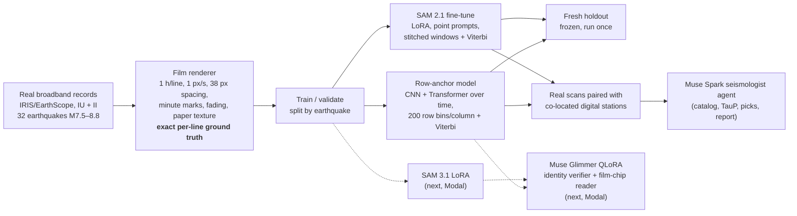

# SeismoRescue

<p align="center">
  <a href="README.md"></a>
  <a href="README.ko.md"></a>
</p>

**Turning tangled analog seismograms back into earthquake waveforms, with learned trace extraction and Meta's SAM.**

<p align="center">
  
</p>
<p align="center"><sub>Fresh-holdout example. A synthetic WWSSN long-period film rendered from the real II.RAYN recording of an earthquake the models never saw (2010-04-06, M7.8), peak swing 8 line spacings.
<b>Green</b>: ground truth. <b>Red</b>: our row-anchor model. <b>Blue</b>: the best classical tracker, which loses the earthquake line as soon as it starts crossing its neighbours.</sub></p>

> [!IMPORTANT]
> **What the Modal credits unlock: two Meta open-weight models move into the critical path.**
> - **SAM 3.1, fine-tuned with LoRA**, becomes the core trace extractor. Our fine-tuned SAM 2.1 already cuts quake-line failures from 55% to 12% in simulation.
> - **Muse Glimmer (30B), fine-tuned with QLoRA**, becomes the trace-identity verifier at every crossing and the film-chip label reader. It is trained on unlimited auto-labelled examples from our benchmark.
> - Neither model fits our local GPUs (M5 Pro 24 GB, RTX 5070 Ti 16 GB). The plan uses **about $99 of the $100 credit** on A100 and H100 hours. See the **[full plan and budget](#what-the-modal-credits-unlock)**.

## TL;DR

- **Problem.** From 1962 to 1978 the World-Wide Standardized Seismograph Network (WWSSN) recorded the world's large earthquakes on photographic film. The USGS released the film-chip scans under CC0 in 2025. Automatic digitization breaks exactly where the signal matters most: the earthquake trace swings across many neighbouring lines, crosses them hundreds of times, and its steep strokes fade on the film.
- **Benchmark.** We built synthetic WWSSN long-period films with exact per-line ground truth, from real recordings of 32 large earthquakes (M7.5–8.8). The geometry is calibrated to real film: 1 px/s, 1 h per line, 38 s of record per line spacing (real film: 40–47 s). We also found two real film scans with a digital station at the same site, which gives real ground truth.
- **Result in simulation.** On a fresh holdout (95 images, 10 unseen earthquakes; each method tested once after freezing), two learned extractors recover the earthquake line, measured as quake-line correlation r and failure rate:
  - Our **row-anchor model**: r **0.96**, 2.0% failure.
  - **Fine-tuned Meta SAM 2.1**: r **0.89**, 12.0% failure.
  - Best classical tracker: r 0.02, 55% failure.
  - Repairing the classical output afterwards, including with a spectrogram U-Net, does not work (r ≈ 0.1).
- **Honest status on real film.** The real earthquake line is **not solved yet**: r 0.19–0.23 on KIP and 0.03–0.10 on MAT, against a chance level of about 0.06. On lines with moderate amplitude the learned models already beat the classical tracker on MAT: r 0.57–0.63 vs 0.01. We think the remaining gap is sim-to-real appearance, and closing it is the next step (see [What the Modal credits unlock](#what-the-modal-credits-unlock)).
- **Meta models.**
  - Muse Spark 1.3 (Meta Model API) runs as a tool-using seismologist agent and crossing judge. We report that it did not beat simple rules.
  - SAM 3.1 (Meta Model API) was tested zero-shot. It returns no instances in contact-dense crops, which is why we fine-tune.
  - SAM 2.1 open weights, fine-tuned, are one of the two learned extractors above.
  - **Next, with Modal credits:**
    - Fine-tune **SAM 3.1** as the core promptable trace extractor.
    - Fine-tune **Muse Glimmer** (30B, open weights) with QLoRA as the trace-identity verifier at crossings and as the film-chip label reader.
    - Both roles are central to the pipeline (see [What the Modal credits unlock](#what-the-modal-credits-unlock)).

## Results at a glance

<picture>
  <source media="(prefers-color-scheme: dark)" srcset="docs/img/chart_quake_r_dark.png">
  
</picture>

| Method (quake line) | Synthetic holdout r | Synthetic failure % | Real KIP r | Real MAT r |
|---|---|---|---|---|
| **Row-anchor + Viterbi** (ours, 0.88 M params) | **0.96** | **2.0** | 0.19 | **0.10** |
| **SAM 2.1 hiera-tiny, fine-tuned** (Meta open weights) | 0.89 | 12.0 | **0.23** | 0.03 |
| Pointer Transformer that repairs B's paths | 0.10 | 22.5 | −0.01 | 0.03 |
| Spectrogram U-Net that repairs B's paths | 0.08 | 22.5 | −0.12 | 0.03 |
| Classical joint tracker (B, our strongest non-learned method) | 0.02 | 55.0 | −0.00 | 0.02 |
| *Reference: a flat line at the baseline* | 0 | 22.5 | – | – |
| *Bound: oracle picks the right B line in every column* | 0.78 | 4.9 | – | – |

- **r** is the Pearson correlation between the extracted quake-line path and the true signal. **Failure** is the % of columns that are missing or more than half a line spacing off. We use r as the primary metric: a flat line "beats" the classical tracker on failure rate (22.5% vs 55%) while recording no waveform at all.
- The synthetic holdout is film_holdout3: 10 earthquakes not used in training, 19 records × 5 amplitudes. Each method was frozen on validation data before a single test run. We re-computed the synthetic-holdout numbers for the row-anchor model, SAM 2.1, B, the flat line and the oracle with separate scripts from saved paths or frozen models ([`results/ml/rescoring`](results/ml/rescoring)); failure rates matched the experiments' own per-image results with 0 mismatches. The repair models' numbers and all real-scan numbers are each experiment's own output; B reproduces the stored real-scan values exactly.
- Real scans are scored against the co-located digital station after simulating the WWSSN response, using one stored time alignment. Details are in [docs/RESULTS.md](docs/RESULTS.md).

<picture>
  <source media="(prefers-color-scheme: dark)" srcset="docs/img/chart_amplitude_dark.png">
  
</picture>

Both learned models stay at r ≥ 0.80 up to an 8-line-spacing swing. The classical tracker never recovers the waveform at any amplitude (r ≤ 0.08).

<p align="center">
  
</p>
<p align="center"><sub>Fine-tuned SAM 2.1 on a holdout record (2009-10-07 M7.7 at IU.MAJO, 4 line spacings). Green: truth, red: SAM 2.1, blue: classical tracker. SAM keeps the line's identity through the crossings; its remaining errors are clipped peaks on the steepest strokes.</sub></p>

## Why it is hard: one picture

<p align="center">
  
</p>
<p align="center"><sub>Synthetic crop at 2× amplitude with 56 trace contacts. SAM 3.1 through the Meta Model API, zero-shot, returns <b>0 instances</b> here. A classical tracker fails on 58% of columns. Every line looks the same, so identity at each crossing has to come from context.</sub></p>

## Real film: where we are

<p align="center">
  
  
</p>
<p align="center"><sub>Real WWSSN LP-Z film at Matsushiro (MAT), 1973-12-28 M7.5 Vanuatu earthquake (EarthScope film-chip product from the USGS WWSSN pilot scanning project, which is documented as part of the USGS CC0 release; not verified file by file). Reference: HG.MAT data via EarthScope FDSN. Top: scan with paths overlaid (red: row-anchor, blue: classical B, orange: DP alignment tool). Bottom: band-passed truth from the co-located HGLP digital station (black) against the extractions.
On the main-shock line the true swing is 4–6 line spacings and the model follows only part of it.</sub></p>

| Real scan, r by line category | Row-anchor | SAM 2.1 ft | Classical B | DP alignment tool |
|---|---|---|---|---|
| MAT quake line (14) | **0.10** | 0.03 | 0.02 | −0.04 |
| MAT neighbours (13, 15) | 0.04 | −0.04 | 0.02 | **0.08** |
| MAT other active lines (7 lines) | **0.63** | 0.57 | 0.01 | 0.49 |
| KIP quake line (16) | 0.19 | **0.23** | −0.00 | 0.09 |
| KIP neighbours (15, 17) | **0.17** | 0.12 | 0.02 | 0.14 |
| KIP other active lines (5 lines) | 0.18 | 0.15 | 0.10 | **0.32** |

What we believe limits real-film performance. These are hypotheses and are being tested now:
1. Steep strokes are nearly invisible on real film, fainter than our renderer draws them.
2. Several neighbouring lines swing hard at the same time (MAT), which is rare in our training data.
3. Scan artefacts that our synthetic films lack.

## What the Modal credits unlock

<picture>
  <source media="(prefers-color-scheme: dark)" srcset="docs/img/chart_modal_budget_dark.png">
  
</picture>

| | **SAM 3.1 fine-tune** | **Muse Glimmer fine-tune** |
|---|---|---|
| **Role in the pipeline** | Core trace extractor for every line, ensembled with the row-anchor model | (1) **Identity verifier**: at each crossing where the extractors disagree, picks the true continuation or flags the segment for human review. (2) **Film-chip reader**: station, date, start time and clock corrections, to seed the time alignment |
| **How** | LoRA at full resolution, with the same frozen-holdout protocol as our SAM 2.1 run | QLoRA on unlimited crossing crops rendered from our benchmark and labelled by its exact ground truth |
| **Why it needs Modal** | Full-resolution LoRA needs A100/H100-class memory | 4-bit weights are about 18 GB, more than our 16 GB GPU. QLoRA is documented for one H100 |
| **Success criterion** | Beats fine-tuned SAM 2.1 (r 0.89) on a fresh holdout of unseen earthquakes; real-scan r reported | Verifier: higher record-level accuracy than our learned logistic judge on unseen earthquakes. Reader: field accuracy on hand-checked labels |
| **Budget (est.)** | ~$27: A100 80 GB, ~9 GPU-hours, 3 runs + evaluation | ~$48: H100 80 GB, ~11 GPU-hours, 2–3 runs + evaluation |

The target pipeline puts Meta models in the critical path:
- **SAM 3.1** and the row-anchor model extract every line.
- **Glimmer** verifies line identity where they disagree and reads the film labels.
- **Muse Spark** orchestrates the run and writes the seismological report.

This is why fine-tuning matters: zero-shot Spark did not help as a crossing judge (fixed 34, broke 60), and zero-shot SAM 3.1 finds nothing where lines touch. Our benchmark provides exact labels in unlimited supply, which is what both models need.

Alongside the Modal work:
- **Sim-to-real, in progress on our own GPUs.**
  - Measure stroke visibility, width, blur and multi-line activity on CC0 film scans that are not used for testing.
  - Randomize the renderer over those ranges and retrain the small row-anchor model locally.
  - Test on a new fresh holdout, then once on the real pairs.
- **More real ground truth.** More WWSSN ↔ HGLP/SRO pairs (ALQ, CTA, CHG, …).
- **Release.** A digitize CLI, the benchmark generator, and the fine-tuned SAM 3.1 and Glimmer adapters. Glimmer runs self-hosted, so the 189k-scan USGS archive can be processed without per-call API cost.

**How the budget was computed.**
- Modal list prices, checked 2026-10-27: A100 80 GB $2.50/h, H100 $3.95/h, plus about $0.44/h for 4 CPU cores and 32 GB of memory.
- The remaining ~$24 covers ablations and final evaluation on A100s.
- Small models stay on local GPUs at $0.

## How it works



- **Row-anchor model** (ours; [`scripts/ml_rowanchor.py`](scripts/ml_rowanchor.py)).
  - Input: a crop of ±10.5 line spacings centred on the target line's baseline at half resolution, plus a start-hint channel (the line's position in its first column, the same start information the classical trackers get).
  - A small CNN pools the rows; a 4-layer Transformer runs along time.
  - Every column is classified into 200 row bins of 4 px. Viterbi decoding uses a step prior learned from training data.
  - Training composites stack other records above and below the target, so crops look like a full 24-line film.
  - 0.88 M parameters; 52 min of training on an Apple M5 Pro (MPS).
- **SAM 2.1 fine-tune** ([`scripts/ml_sam.py`](scripts/ml_sam.py)).
  - The single-image path of SAM 2.1 hiera-tiny is re-implemented in plain PyTorch, and the official weights load with strict key and shape checks.
  - LoRA is applied to the trunk, and the mask decoder is trained.
  - Each window is the full height × 256 columns, resized to 1024². The first window is prompted with the start point; later windows get 4 points from the path decoded so far. A Viterbi pass stitches the windows.
  - 45 min of training on MPS.
- **Classical baselines** ([`scripts/track_joint.py`](scripts/track_joint.py), [`scripts/arbiter.py`](scripts/arbiter.py)).
  - A is a greedy tracker. B is a joint multi-line tracker with physics-based coasting.
  - A learned judge picks between A and B where they disagree.
  - On the original 4 px/s geometry this judge cut whole-image failures by 11.5 points against the greedy tracker (2.5 points against the better of the two trackers per record) on a pre-registered holdout. It does not survive real film geometry.
- **Repair models** ([`scripts/ml_repair.py`](scripts/ml_repair.py)). These map B's per-line paths, not the image, to the true waveform. They failed: from B's per-line paths they did not undo identity swaps, while the image-based models did.

## Meta models in this project

| Model | Role | What we measured |
|---|---|---|
| **Muse Spark 1.3** (Meta Model API, `muse-spark-1.3-contributor`) | Tool-using seismologist agent over digitized traces: event catalog + TauP travel times, STA/LTA, AIC picker, plots. Also tested as an A/B judge at trace crossings. | Two independent runs agree on 93–94% of records; about $1.7 per 96-run pass. It **did not beat simple rules**: P-arrival within 10 s 0.67 vs 0.71 for theoretical travel times. As a crossing judge it fixed 34 and broke 60 events on the strongest judge (not significant at the record level, trend toward harm). Spark therefore orchestrates and reports; measurement is done by tools. |
| **SAM 3.1** (Meta Model API) | Zero-shot trace segmentation | Fine on isolated lines. Returns **0 instances** in crops where lines touch 56–212 times. With one active line and 28–40 contacts it follows that line (≤ 0.2% failure) but drops the quiet lines (40–69% failure over all lines). |
| **SAM 2.1 hiera-tiny** (open weights, Apache-2.0) | Fine-tuned promptable trace segmenter | Synthetic holdout r 0.89. Quake-line failure 55% → 12%. Real KIP r 0.23. |
| **SAM 3.1** (open weights, gated) | **Next (Modal): the core trace extractor.** LoRA fine-tune with the same frozen-holdout protocol as SAM 2.1, then ensemble with the row-anchor model | Planned |
| **Muse Glimmer** (open weights, 30B, image + text input, Apache-2.0) | **Next (Modal), two key roles.** (1) **Trace-identity verifier**: at every crossing where extractors disagree, Glimmer sees the candidate continuations drawn on the crop and picks the true one, or flags the segment for human review. It is QLoRA-trained on unlimited auto-labelled crossing crops from our benchmark, which has exact ground truth. (2) **Film-chip reader**: reads the station, date, start time and clock-correction labels to seed each scan's time alignment (in our real-scan evaluation the label times alone were not enough, so they initialise the fitted alignment), self-hosted for bulk digitization | Planned and untested. Zero-shot Spark did not help as a judge (fixed 34, broke 60), so we will train on exact labels instead. Glimmer is 18 GB even in 4-bit, so it needs an H100 |

## Evaluation protocol

- **Exact ground truth.** The renderer stores the pen centreline of every line. A half-pixel offset bug was found in review, fixed and re-measured (residual 0.003 px).
- **Splits by earthquake.** Development uses GroupKFold by event date (4 folds × 3 shuffles); the same event never appears in train and test.
- **Fresh holdouts; each method tested once.** Three holdouts of 10 new earthquakes each: two with pre-registered hypotheses for the classical system, and film_holdout3 for the learned models (three experiments each tested their frozen method on it once). Confidence intervals come from cluster bootstrap over records.
- **Independent checks.**
  - Holdout numbers were re-computed by separate scripts ([`results/ml/rescoring`](results/ml/rescoring)).
  - An independent reviewer pass compared the write-up with the result files; it caught over-claims in our own drafts, which we corrected.
  - Negative results are reported: the Spark judge, the Spark agent vs simple rules, the repair models, and real-film transfer.
- **Real ground truth.** Two WWSSN LP film chips have an HGLP digital station at the same site and an unclipped digital record:
  - MAT: 1973-12-28 M7.5.
  - KIP: 1975-02-02 M7.6.
  - The digital record is converted to the WWSSN LP response. The scan-to-time alignment was fitted once and stored before any method was scored. The real line period is 3588–3589 s, not 3600 s.

## Repository layout

| Path | Contents |
|---|---|
| [`scripts/`](scripts) | All code: renderer, classical trackers and judges, learned models, real paired evaluation, Spark agent tools |
| [`data/`](data) | Benchmark waveforms (miniSEED, IU/II) and event catalogue. See [data/README.md](data/README.md) for sources, licences and how to fetch the real scans |
| [`results/`](results) | Result files: `early/` (first experiments), `early/multiagent/` (CV, holdouts, Spark runs), `ml/` (learned models, real paired eval, re-scoring) |
| [`checkpoints/`](checkpoints) | Frozen row-anchor model (3.5 MB) and fine-tuned SAM 2.1 tiny (19 MB) with their frozen decode settings |
| [`docs/`](docs) | [RESULTS.md](docs/RESULTS.md) (all experiments, conditions and numbers), [METHODS.md](docs/METHODS.md), figures |
| [`tools/`](tools) | Rebuild the README summary and charts from the result files |

## Reproduce

```bash
./setup_env.sh                                   # Python 3.12 venv with pinned packages (needs uv)
SKIP_API=1 ./run_all.sh                          # first experiments, offline part (no API key needed)

# Film-geometry benchmark: render training and holdout films from the shipped waveforms
for f in data/film_dev/*.mseed; do t=$(basename "$f" .mseed); .venv/bin/python -I scripts/render_helicorder.py "$f" out/film_train/$t film 1,2,3,4,6,8; done
for f in data/film_holdout3/*.mseed; do t=$(basename "$f" .mseed); .venv/bin/python -I scripts/render_helicorder.py "$f" out/film_holdout3/$t film 1,2,4,6,8; done

# Row-anchor model: train, choose decoding on validation, freeze, test once
.venv/bin/python -I scripts/ml_rowanchor.py split
.venv/bin/python -I scripts/ml_rowanchor.py train 50
.venv/bin/python -I scripts/ml_rowanchor.py cacheB val && .venv/bin/python -I scripts/ml_rowanchor.py cacheB holdout   # classical B for comparison
.venv/bin/python -I scripts/ml_rowanchor.py val && .venv/bin/python -I scripts/ml_rowanchor.py freeze
.venv/bin/python -I scripts/ml_rowanchor.py holdout

# Or evaluate the shipped checkpoints
mkdir -p out/ml/rowanchor && cp checkpoints/rowanchor/* out/ml/rowanchor/
python tools/collect_summary.py && python tools/make_figures.py   # rebuild README numbers and charts
```

- Spark and SAM 3.1 steps need a Meta Model API key in `MODEL_API_KEY`.
- The real paired evaluation needs the two film scans and the HGLP records; [data/README.md](data/README.md) says where to get them.
- Full command lists are in the docstrings at the top of each script.

## Data and licences

- Code: MIT ([LICENSE](LICENSE)).
- The fine-tuned SAM 2.1 checkpoint is a derivative of Meta's SAM 2.1 (Apache-2.0).
- Waveforms: IRIS/EarthScope FDSN, networks IU ([doi:10.7914/SN/IU](https://doi.org/10.7914/SN/IU)) and II ([doi:10.7914/SN/II](https://doi.org/10.7914/SN/II)).
- WWSSN film chip scans: USGS ([doi:10.5066/P13PHZMA](https://doi.org/10.5066/P13PHZMA), CC0 1.0) and the EarthScope film chip product ([doi:10.17611/DP/FC.1](https://doi.org/10.17611/DP/FC.1)); the MAT scan comes from the latter, which is documented as part of the CC0 release (not verified file by file). The KIP scan is a local copy from a mirror. Until we fetch it from the USGS CC0 release itself, this repository contains **no KIP image**, only metrics.
- See [THIRD_PARTY_NOTICES.md](THIRD_PARTY_NOTICES.md).

Built solo for the Meta Global AI Developer Hackathon (Oct 26 – Nov 4, 2026, Indie track). Development was assisted by AI coding tools, as the rules allow.
