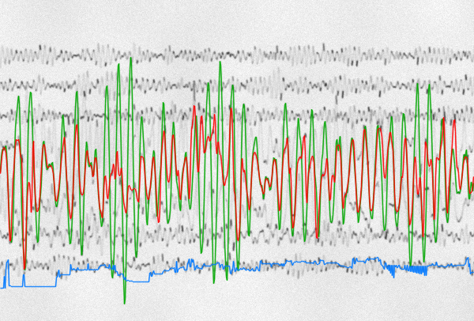
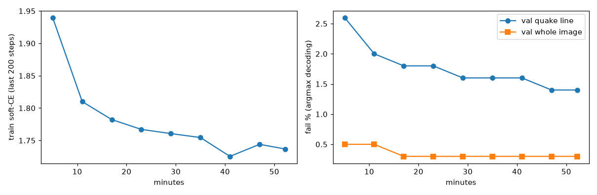
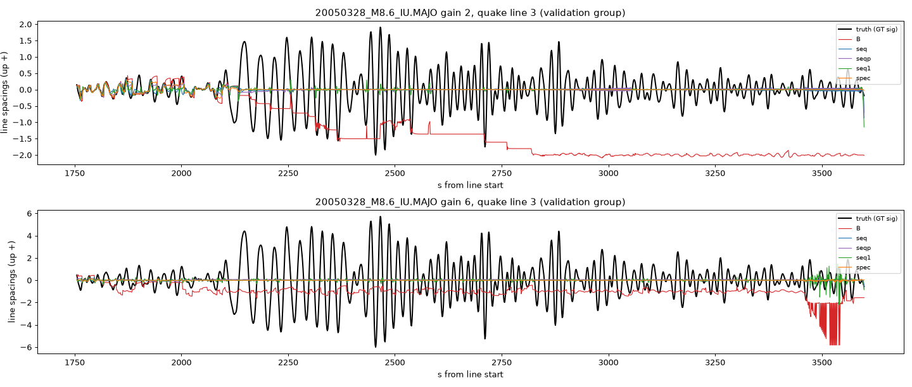

# Results: every experiment, its conditions and its numbers

This page lists what we ran, under which conditions, and what came out, including the experiments that failed. All numbers come from the files in [`results/`](../results). The headline learned-model numbers were re-computed by separate scripts in [`results/ml/rescoring`](../results/ml/rescoring), with 0 per-image mismatches.

**Metrics.**
- **Failure %**: share of drawn columns where a line's path is missing or more than half a line spacing from the true pen position.
- **r**: Pearson correlation between the extracted path and the true signal of that line. It is the primary metric because the failure rate rewards a flat line.
- **Real scans** use the same r after a 0.0025–0.08 Hz band-pass (`r_band`), plus two more measures: the share of samples within 0.1 line spacing of the truth (`in`) and the share more than 0.5 spacing away (`lost`).

## Datasets

| Set | Geometry | Earthquakes | Records (images) | Used for |
|---|---|---|---|---|
| `bench` | 4 px/s, 15 min per line, 48 px spacing (12 s per spacing) | 12 | 24 | development CV of the classical system |
| `bench_holdout` (holdout 1) | same | 10 new | 20 | pre-registered test, H1–H3 |
| `bench_holdout2` (holdout 2) | same | 10 new | 20 | pre-registered test, H4–H8 |
| `film_dev` → `film_train` | **film**: 1 px/s, 1 h per line, 38 px spacing (38 s per spacing), 8 h records | 22 | 43 (× gains 1, 2, 3, 4, 6, 8 = 258) | training and validation of learned models, split by earthquake |
| `film_holdout3` | film | 10 new | 19 (× gains 1, 2, 4, 6, 8 = 95) | final test, run once per frozen method |
| Real pairs | WWSSN LP-Z film rescaled to 38 px spacing | 2 | MAT 1973-12-28 M7.5, KIP 1975-02-02 M7.6 | real ground truth from the co-located HGLP digital station |

- "Gain" is the earthquake line's peak deflection in line spacings.
- Real WWSSN long-period film carries 40–47 s of record per line spacing. The film geometry (38 s) is calibrated to that. The first geometry (12 s) stretches time 3–4× relative to real film and makes slopes too gentle.
- Waveforms are LHZ recordings from the IU and II networks, band-passed to 0.01–0.2 Hz in film mode. The earthquake starts on line 2–5 of an 8-line record, and the other lines carry that station's real background noise.

---

## Stage 1: why automatic digitization fails (first geometry)

**Conditions.** Synthetic crops at 15 min per line. "All lines" means every line carries signal. "Touch-dense" crops were chosen for contacts. "One active line" means only the strongest line moves. SAM 3.1 was called zero-shot through the Meta Model API with a concept prompt ([`results/early/sam_crossings_results.json`](../results/early/sam_crossings_results.json)).

| Crop | Trace contacts | SAM 3.1 instances | SAM 3.1 failure %, all lines | SAM 3.1 failure %, active line | Classical failure %, all lines |
|---|---|---|---|---|---|
| all lines, 0.8× | 0 | 5 | 0.0 | – | 0.0 |
| all lines, 2× | 2 | 5 | 0.0 | – | 23.9 |
| all lines, 5× | 143 | **0** | 100 | – | 62.7 |
| touch-dense, 2× | 56 | **0** | 100 | – | 57.7 |
| touch-dense, 5× | 212 | **0** | 100 | – | 87.6 |
| one active line, 1× | 2 | 5 | 0.1 | 0.0 | 32.4 |
| one active line, 1.5× | 28 | 3 | 40.0 | 0.2 | 30.5 |
| one active line, 2× | 40 | 1 | 68.7 | 0.0 | 58.5 |

With one active line, SAM 3.1 follows that line through 28–40 contacts but drops the quiet lines. With contacts everywhere it returns nothing.

- **Muse Spark** reads record labels reliably. It cannot measure sample values from the image: the sign of the deflection agrees only 40% of the time.
- **Conclusion.** The core difficulty is line identity at crossings. Language and vision models should choose between candidates that tools have measured, not measure themselves.

## Stage 2: a multi-agent digitizer with Meta Muse Spark (first geometry)

**Design.** Two proposers produce paths:
- A: a greedy tracker.
- B: a joint multi-line tracker with physics-based coasting.

Where A and B disagree, a judge picks one: a rule, or a learned logistic-regression judge on physical features, where baseline centring was the key feature. Muse Spark was tested as the judge for the least confident 15% of events, asked twice with the order swapped.

**Development CV** (24 records, GroupKFold by event date, 4 folds × 3 shuffles; gain 2, all lines, whole-image failure %):

| A greedy | B joint | Rule judge | Learned judge | Oracle (ground-truth choice) |
|---|---|---|---|---|
| 27.9 | 27.4 | 26.5 | **18.7** | 15.2 |

**Pre-registered holdouts** (method frozen first; cluster-bootstrap 95% CI over records):

| Hypothesis | Holdout | Result |
|---|---|---|
| H1: learned judge beats A, all lines at 2× | 1 | **−11.5 points** [−15.6, −7.3], supported |
| H2: learned judge beats the better of A and B per record | 1 | −2.5 [−4.4, −0.5], supported |
| H3: same, active-line records at 2×, whole image | 1 | −2.2, supported |
| Active line at 1.5× | 1 | learned judge **worse** than A by +9.4 [+2.5, +17.5] |
| H4: active-line fix (residual-ink detector + clean re-tracking) at 2× | 2 | active line failure 31.6% → **9.9%**, −21.7 [−32.7, −10.5], supported |
| Active-line fix at 1.5× | 2 | 20.7% → 16.1%, not significant |
| All lines at 2×, whole image: system vs A | 2 | −17.3 |

**Muse Spark as a judge and as an agent** (honest negative results):

| Test | Result |
|---|---|
| Spark A/B judge on the least confident 15% of events, weak (v1) judge | helped, −2.0 points |
| Same on the strong (v5) judge | fixed 34 events, broke 60; not significant at the record level (trend toward harm). Stated confidence was uninformative; test–retest 86.5%; order-swap consistency 77% |
| Spark seismologist agent with tools: P arrival within 10 s | agent 0.67 vs theoretical travel time 0.71 vs AIC picker 0.65 |
| Same, time of the surface-wave maximum within 60 s | agent 0.40 vs narrow-window rule 0.46 |
| Same, agreement between two independent runs and cost | 93% (P) and 94% (surface) of 95 records; about $1.7 per 96-run pass |

The agent's tools are catalog + TauP, STA/LTA, the AIC picker, peak finding and plots. Per-record scores are in [`results/early/multiagent/agent_eval_items.json`](../results/early/multiagent/agent_eval_items.json): P is scored on the 48 all-lines records and the surface wave on all 96. A first draft of the agent evaluation reported gains that came from a mis-built baseline. An independent review caught this; the table shows the corrected numbers.

## Stage 3: moving to real film geometry

- **Applied as is to a real film chip, the frozen system does not transfer.** The main cause is time scale: real long-period film runs at about 1 px/s, against 4 px/s in the first benchmark, so slopes relative to the line spacing are 3–4× steeper. Other differences are dot-like minute marks, microseism on the quiet lines, uneven spacing and skew.
- **Calibrated film benchmark, development CV** (43 records). Failure % at gains 1 / 1.5 / 2:

| | A greedy | B joint | Learned judge | Judge + active-line fix |
|---|---|---|---|---|
| Whole image | 71.6 / 66.5 / 68.5 | **4.0 / 11.5 / 15.5** | 3.9 / 11.4 / 15.1 | 7.8 / 12.9 / 16.3 |
| Earthquake line | 88.1 / 85.3 / 84.9 | **16.7 / 41.3 / 52.0** | 17.0 / 41.2 / 52.8 | 42.5 / 53.6 / 62.2 |

  The calibrated synthetic reproduces the real failure mode: the greedy trackers collapse. Column-by-column tracking breaks on near-vertical, faint strokes.
- **Real paired evaluation.** On both real scans the earthquake-line r of A, B and the judge is about 0. The true amplitudes are 4.8–8.7 line spacings, and the real line period is 3588–3589 s, not 3600 s.

## Stage 4: learned trace extraction (main result)

### Synthetic holdout (film_holdout3, 95 images, each method run once after freezing)

Quake-line r / failure % by amplitude:

| Gain | Row-anchor + Viterbi | SAM 2.1 (our fine-tune) | Classical B |
|---|---|---|---|
| 1 | 0.98 / 0.0 | 0.95 / 0.0 | 0.08 / 28.4 |
| 2 | 0.99 / 0.0 | 0.95 / 1.5 | 0.02 / 39.0 |
| 4 | 0.99 / 0.4 | 0.95 / 7.8 | 0.00 / 64.6 |
| 6 | 0.95 / 2.9 | 0.80 / 24.0 | 0.01 / 73.0 |
| 8 | 0.87 / 6.8 | 0.80 / 26.6 | 0.00 / 70.2 |
| **all** | **0.96 / 2.0** | **0.89 / 12.0** | **0.02 / 55.0** |

- **Neighbouring lines, r:** row-anchor 0.66, SAM 2.1 0.58, B 0.09.
- **Whole-image failure:** row-anchor 0.4%, SAM 2.1 2.0%, B 25.2%.
- **Row-anchor:** no failure run reaches 100 columns; the longest is 44. What remains is undershoot at the peaks of steep high-gain strokes.
- **SAM 2.1:** loses the line only when a record starts mid-swing and the single start point is ambiguous. Its worst record has r −0.07.

Worst row-anchor case at 8×. The model keeps the phase but clips the peaks; the classical tracker attaches to the lower line.

**Validation, used only to choose the decoding** (quake / whole-image failure %):
- **Row-anchor:** Viterbi with α = 4 gives 1.2 / 0.2; argmax gives 1.4 / 0.3; B gives 60.2 / 25.7.
  - α was chosen among six decoding variants (α 0.5–4, with and without a heavy-tailed step prior) by lowest validation error.
  - The holdout run used exactly this frozen setting ([`results/ml/rowanchor/frozen.json`](../results/ml/rowanchor/frozen.json)).
- **SAM 2.1:** 7.9 / 1.4 against B's 50.5 / 22.9. This uses a different validation split from the row-anchor model.
- **SAM 2.1 without fine-tuning** is worse than B: 30.7% whole-image failure on validation.

### Repairing the classical output does not work

**Conditions.** These models see B's per-line paths, not the image, and must output the true waveform of the target line:
- A multi-line pointer Transformer that picks which B line carries the target at each column, plus a residual.
- The same model trained directly on oracle pointer labels.
- An own-line-only model.
- A spectrogram U-Net (STFT → 2D U-Net → inverse STFT).

| Synthetic holdout, quake line | r | Failure % |
|---|---|---|
| B | 0.02 | 55.0 |
| Flat line at the baseline | 0 | 22.5 |
| Pointer Transformer | 0.10 | 22.5 |
| Pointer + oracle labels | 0.06 | 23.1 |
| Own line only | 0.07 | 22.7 |
| Spectrogram U-Net | 0.08 | 22.5 |
| Oracle: nearest B line in every column (bound) | 0.78 | 4.9 |

Every model converged to the flat line's failure rate. The models learned to shrink B toward the baseline instead of undoing swaps. Even the oracle stops at r 0.78, because some large strokes are drawn by no B line at all: few columns, but a large share of the waveform energy. On the real scans these models stay at chance (r −0.12 to 0.05).

### Real paired scans

r_band / in / lost for each method:

| Scan, lines | Row-anchor | SAM 2.1 (our fine-tune) | Classical B | DP alignment tool | Flat line |
|---|---|---|---|---|---|
| KIP quake (16) | 0.19 / 0.39 / 0.42 | **0.23** / 0.13 / 0.43 | −0.00 / 0.09 / 0.53 | 0.09 / 0.47 / 0.37 | – / 0.48 / 0.37 |
| KIP neighbours | **0.17** / 0.40 / 0.38 | 0.12 / 0.41 / 0.38 | 0.02 / 0.18 / 0.40 | 0.14 / 0.42 / 0.38 | – / 0.41 / 0.38 |
| KIP other active (5) | 0.18 / 0.52 / 0.14 | 0.15 / 0.41 / 0.22 | 0.10 / 0.29 / 0.27 | **0.32** / 0.54 / 0.13 | – / 0.54 / 0.15 |
| MAT quake (14) | **0.10** / 0.17 / 0.55 | 0.03 / 0.14 / 0.58 | 0.02 / 0.07 / 0.71 | −0.04 / 0.31 / 0.56 | – / 0.33 / 0.55 |
| MAT neighbours | 0.04 / 0.53 / 0.38 | −0.04 / 0.52 / 0.39 | 0.02 / 0.14 / 0.40 | **0.08** / 0.50 / 0.37 | – / 0.52 / 0.39 |
| MAT other active (7) | **0.63** / 0.56 / 0.11 | 0.57 / 0.56 / 0.11 | 0.01 / 0.21 / 0.32 | 0.49 / 0.51 / 0.12 | – / 0.51 / 0.16 |

- **Chance level** for |r| is about 0.066 on KIP and 0.061 on MAT.
- **The real earthquake line is not recovered yet.** On the quake line both learned models have a lower "in" fraction than a flat line.
- **Lines with moderate amplitude are read well on MAT.** On KIP the DP alignment tool is still better on those lines.
- **Quiet lines** carry 6–8 s microseism that the HGLP reference does not contain, so r cannot score them.
- **The figures show no KIP imagery** because of its licence status; MAT figures are in the [README](../README.md#real-film-where-we-are).

---

## Integrity log: what we found wrong in our own work, and fixed

- **Renderer ground truth was off by half a pixel** (y −0.50 px, x −0.375 px), from integer flooring and the pixel-centre convention. It was fixed and re-measured at a residual of 0.003 px. All earlier within-1-px numbers were biased until then.
- **An early claim that SAM 3.1 had "0% wrong-trace at 2×" was withdrawn.** That crop had only 2 contacts. On contact-dense crops SAM returns no instances (Stage 1 table).
- **The first Spark seismologist evaluation used a wrong baseline.** The P baseline window was tuned on noise-reference items, and one surface-wave baseline was a strawman. An independent review found this; corrected, the agent does not beat simple rules.
- **A learned-judge comparison had hidden the active-line weakness**, and its significance test treated events as independent. It was corrected to record-level clustering.
- **Our learned-model synthesis was checked cell by cell** by an independent reviewer. Over-claims about real-line improvements and about why repair failed were corrected before release.
